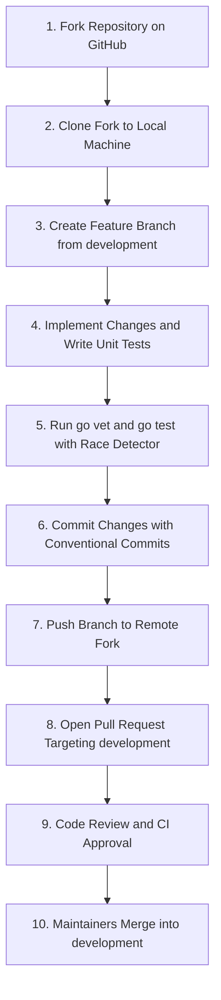

# Contribution Guidelines

This document provides instructions for contributing code to `nvx-go-telemetry`.

---

## 1. Contribution Workflow

The diagram below shows the branch lifecycle and pull request process.



---

## 2. Branch Organization

The project uses a structured branching model:
- The `main` branch stores stable production releases.
- The `development` branch stores ongoing integration changes.
- Create topic branches from the `development` branch.
- Use one of the following prefixes for branch names:
  - `feature/`
  - `bugfix/`
  - `refactor/`
  - `test/`
  - `doc/`
  - `ci/`

---

## 3. Reporting Issues

Follow these instructions to report defects or request features:
1. Search open and closed issues on GitHub to prevent duplicate entries.
2. Open a new issue if no matching defect exists.
3. Provide a clear description of the defect.
4. Include minimal reproduction steps or Go test code.
5. Do not post security vulnerabilities to public issues.
6. Send security reports to: `satrianursaputro06@gmail.com`.

---

## 4. Development and Pull Request Procedure

Follow these procedural steps to contribute code changes:

### Step 1: Prepare the Local Environment
1. Fork the repository to your personal GitHub account.
2. Clone the forked repository to your local computer:
   ```bash
   git clone https://github.com/<your-username>/nvx-go-telemetry.git
   ```
3. Change the directory to the repository folder:
   ```bash
   cd nvx-go-telemetry
   ```
4. Create a topic branch from the `development` branch:
   ```bash
   git checkout -b feature/my-feature-name origin/development
   ```

### Step 2: Implement and Validate Changes
1. Write Go code following standard style guidelines.
2. Add unit tests for all new functions.
3. Verify test coverage and race safety:
   ```bash
   go test -v -race ./...
   ```
4. Execute static code analysis:
   ```bash
   go vet ./...
   ```
5. Format source files using the standard tool:
   ```bash
   gofmt -w .
   ```

### Step 3: Commit and Submit
1. Create descriptive commit messages using Conventional Commits format.
2. Example commit message format:
   ```text
   feat: add support for custom trace samplers
   ```
3. Push your branch to your remote fork:
   ```bash
   git push origin feature/my-feature-name
   ```
4. Open a pull request against the `development` branch on GitHub.
5. Complete all items in the pull request description checklist.
