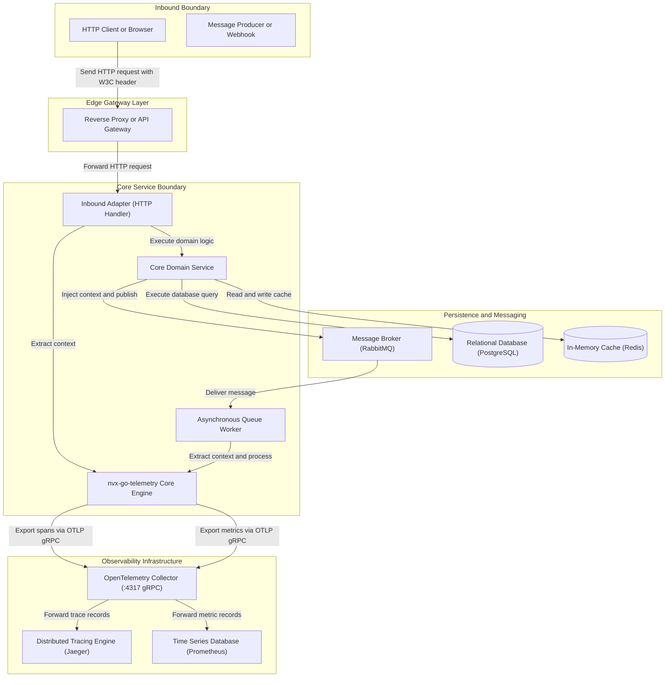
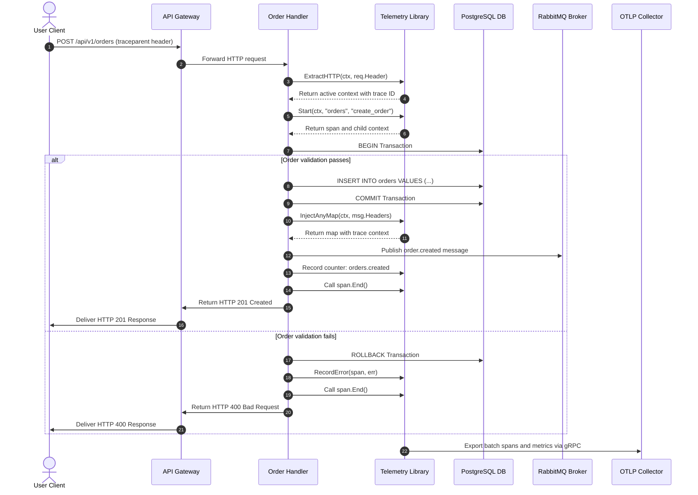
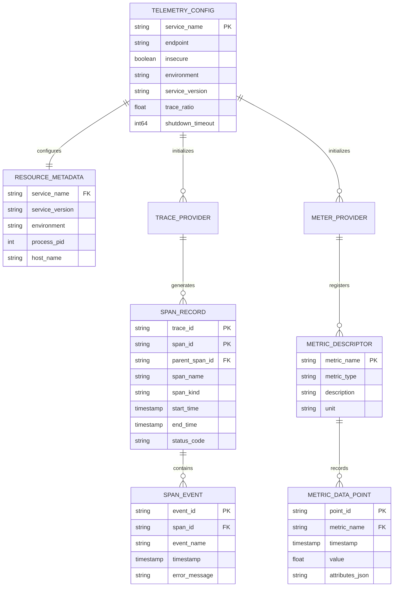
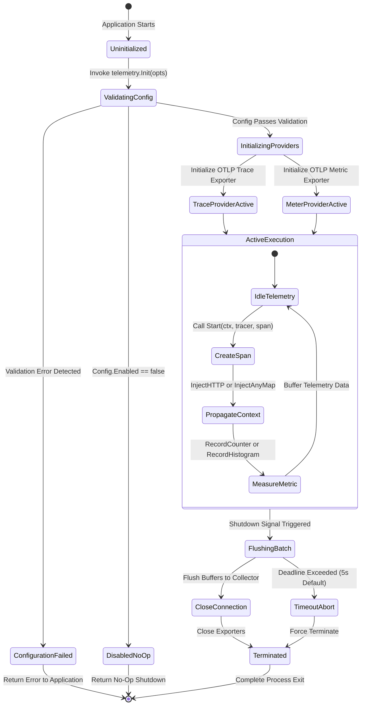

# nvx-go-telemetry

[](https://pkg.go.dev/github.com/Jkenyut/nvx-go-telemetry)
[](https://goreportcard.com/report/github.com/Jkenyut/nvx-go-telemetry)
[](LICENSE)
[](#8-verification-testing-and-health-check)

The `nvx-go-telemetry` module provides OpenTelemetry instrumentation for Go applications. It configures trace and metric providers with high-throughput OTLP gRPC exporters. The library propagates W3C distributed trace context across HTTP APIs and message brokers.

---

## 1. System Architecture and Data Flows

The system architecture integrates core application services with downstream observability collectors.

### 1.1 System Topology and Component Architecture



The application core extracts trace context from inbound HTTP headers. It injects W3C context headers into outbound message broker payloads. Batch processors flush telemetry spans and metric data points to the OpenTelemetry Collector via gRPC connections.

---

### 1.2 Core Transaction Workflow



The sequence diagram models the end-to-end transaction lifecycle. The handler creates child spans and propagates context through every database and messaging operation.

---

## 2. Data Schema and Lifecycle Operations

The telemetry engine models structured resources, span records, events, and metric descriptors.

### 2.1 Data Entity Relationship Model



The entity model defines the schema for telemetry resources and records. Spans maintain parent-child hierarchy across asynchronous operations.

---

### 2.2 Lifecycle and State Machine



The state machine controls exporter startup, buffering, and graceful shutdown. The shutdown handler guarantees complete buffer flushes before application termination.

---

## 3. Prerequisites and Tooling

Install the verified tools listed in the table below:

| Component | Version | Role / Purpose |
| :--- | :--- | :--- |
| Go Compiler | 1.24+ / 1.26+ | Compiles the telemetry library and test suites. |
| OpenTelemetry Collector | 0.95.0+ | Receives OTLP gRPC telemetry traces and metrics. |
| Docker Engine | 26.0+ | Executes local container infrastructure. |
| Docker Compose | v2.26+ | Orchestrates multi-container local environments. |
| GolangCI-Lint | v1.60+ | Executes static analysis and style checks. |

---

## 4. Directory Structure

The repository maintains strict modular separation between tracing, metrics, and propagation:

```text
.
├── .github/                # Stores GitHub Actions continuous integration workflows.
│   └── workflows/
│       └── ci.yml          # Executes automated test and lint pipelines.
├── docs/                   # Stores extended technical documentation.
│   ├── architecture/
│   │   └── sequences.md    # Documents architecture flows and sequence diagrams.
│   └── modules/
│       ├── carrier.md      # Context propagation guide (HTTP, AMQP, AnyMap).
│       ├── configuration.md # Configuration options, defaults, and validation.
│       ├── metrics.md      # MetricManager, cached instruments, and reader.
│       └── tracing.md      # Tracing helpers, span limits, and error capture.
├── telemetry/              # Implements the OpenTelemetry library.
│   ├── carrier.go          # Implements HTTP and AnyMap context propagation.
│   ├── carrier_test.go     # Validates context injection and extraction.
│   ├── config.go           # Defines telemetry configuration and validators.
│   ├── metrics.go          # Implements MetricManager and instrument wrappers.
│   ├── otel.go             # Initializes trace and meter providers.
│   ├── otel_test.go        # Validates provider initialization and shutdown.
│   └── trace.go            # Implements span creation and error logging.
├── CONTRIBUTING.md         # Explains contribution rules and branch standards.
├── LICENSE                 # Contains the Apache 2.0 software license.
├── Makefile                # Defines build, lint, and test targets.
├── README.md               # Documents system architecture and instructions.
├── go.mod                  # Declares module dependencies and Go version.
└── go.sum                  # Contains cryptographic checksums of dependencies.
```

---

## 5. Configuration Parameters

Configure telemetry through functional options or mapped environment variables:

| Variable | Type | Default | Description (ASD-STE100) |
| :--- | :--- | :--- | :--- |
| `OTEL_ENABLED` | boolean | `true` | Enables or disables telemetry operations. |
| `OTEL_EXPORTER_OTLP_ENDPOINT` | string | `localhost:4317` | Sets the OTLP gRPC target host and port. |
| `OTEL_EXPORTER_OTLP_INSECURE` | boolean | `true` | Disables TLS encryption for gRPC transport. |
| `OTEL_SERVICE_NAME` | string | `nvx-go-telemetry` | Sets the logical service resource name. |
| `OTEL_ENVIRONMENT` | string | `""` | Sets the deployment environment name. |
| `OTEL_SERVICE_VERSION` | string | `""` | Sets the semantic service version. |
| `OTEL_ENABLE_TRACE` | boolean | `true` | Enables or disables the distributed tracer. |
| `OTEL_ENABLE_METRICS` | boolean | `true` | Enables or disables the metric reader. |
| `OTEL_TRACE_RATIO` | float | `1.0` | Sets sampling ratio from 0.0 to 1.0. |
| `OTEL_SHUTDOWN_TIMEOUT` | duration | `5s` | Sets the buffer flush timeout limit. |

> [!NOTE]
> Do not include URL schemes in `OTEL_EXPORTER_OTLP_ENDPOINT`. The gRPC client requires host and port only. For full configuration parameters and validation rules, see the [Configuration Guide](docs/modules/configuration.md).

---

## 6. Installation and Execution Procedure

Follow these procedural steps to install, configure, and execute the service.

### Step 1: Install Package Dependency

Add the module to your Go service:

```bash
go get github.com/Jkenyut/nvx-go-telemetry
```

### Step 2: Initialize Docker Environment

Create a `docker-compose.yml` file to run the OpenTelemetry Collector:

```yaml
services:
  otel-collector:
    image: otel/opentelemetry-collector-contrib:0.95.0
    command: ["--config=/etc/otelcol-contrib/config.yaml"]
    volumes:
      - ./otel-collector-config.yaml:/etc/otelcol-contrib/config.yaml:ro
    ports:
      - "4317:4317" # OTLP gRPC
      - "4318:4318" # OTLP HTTP
      - "8889:8889" # Prometheus metrics exporter

  jaeger:
    image: jaegertracing/all-in-one:1.54
    ports:
      - "16686:16686" # Jaeger Web UI
```

### Step 3: Start Container Infrastructure

Start the local telemetry stack:

```bash
docker compose up -d
```

### Step 4: Stop Container Infrastructure

Stop all running containers:

```bash
docker compose down
```

---

## 7. API and Operational Interface

The table summarizes all primary library functions and methods across core modules:

| Function Interface | Operational Module | Functional Role (ASD-STE100) |
| :--- | :--- | :--- |
| `telemetry.Init(ctx, opts...)` | Core Lifecycle | Initializes providers and returns shutdown handler. |
| `telemetry.WithConfig(cfg)` | Configuration | Applies settings from an existing Config struct. |
| `telemetry.DefaultConfig()` | Configuration | Returns standard configuration defaults. |
| `telemetry.Tracer(name)` | Tracing | Returns a named OpenTelemetry tracer. |
| `telemetry.Start(ctx, tracer, span)` | Tracing | Starts a child span with context. |
| `telemetry.RecordError(span, err)` | Tracing | Records an error event and sets error status. |
| `telemetry.TraceID(ctx)` | Tracing | Returns active hexadecimal trace ID string. |
| `telemetry.SpanID(ctx)` | Tracing | Returns active hexadecimal span ID string. |
| `telemetry.InjectHTTP(ctx, header)` | Propagation | Writes W3C trace headers to HTTP request. |
| `telemetry.ExtractHTTP(ctx, header)` | Propagation | Reads W3C trace headers from HTTP request. |
| `telemetry.InjectHTTPHeader(ctx, header)` | Propagation | Acts as an alias for `InjectHTTP`. |
| `telemetry.ExtractHTTPHeader(ctx, header)` | Propagation | Acts as an alias for `ExtractHTTP`. |
| `telemetry.InjectAnyMap(ctx, map)` | Propagation | Injects trace context into messaging map headers. |
| `telemetry.ExtractAnyMap(ctx, map)` | Propagation | Extracts trace context from messaging map headers. |
| `telemetry.InjectAMQP(ctx, map)` | Propagation | Acts as an alias for `InjectAnyMap`. |
| `telemetry.ExtractAMQP(ctx, map)` | Propagation | Acts as an alias for `ExtractAnyMap`. |
| `telemetry.NewMetricManager(name)` | Metrics | Instantiates metric registry wrapper with cached instruments. |
| `mm.RegisterCounter(name, desc)` | Metrics | Registers or retrieves a cached integer counter. |
| `mm.RegisterUpDownCounter(name, desc)` | Metrics | Registers or retrieves a cached up-down counter. |
| `mm.RegisterHistogram(name, desc, unit)` | Metrics | Registers or retrieves a cached float64 histogram. |
| `mm.MeasureFunc(name, desc, callback)` | Metrics | Registers a callback to record an observable gauge. |

Detailed operational guides are available in the module references:
- [Context Propagation Guide](docs/modules/carrier.md)
- [Distributed Tracing Guide](docs/modules/tracing.md)
- [Metrics Management Guide](docs/modules/metrics.md)
- [Configuration Reference](docs/modules/configuration.md)
- [System Sequences and Architecture Workflows](docs/architecture/sequences.md)

### Go Application Code Example

Initialize telemetry at application startup:

```go
package main

import (
	"context"
	"log"
	"net/http"
	"time"

	"github.com/Jkenyut/nvx-go-telemetry/telemetry"
)

func main() {
	ctx := context.Background()

	// Initialize OpenTelemetry providers
	shutdown, err := telemetry.Init(ctx,
		telemetry.WithEnabled(true),
		telemetry.WithServiceName("order-service"),
		telemetry.WithEnvironment("production"),
		telemetry.WithServiceVersion("v1.2.0"),
		telemetry.WithEndpoint("localhost:4317"),
		telemetry.WithInsecure(true),
		telemetry.WithTraceRatio(1.0),
		telemetry.WithShutdownTimeout(5000), // in milliseconds (5s)
	)
	if err != nil {
		log.Fatalf("Initialization error: %v", err)
	}
	defer shutdown(context.Background())

	// Initialize metrics manager
	mm := telemetry.NewMetricManager("order-service")
	orderCounter, err := mm.RegisterCounter("orders.processed", "Total processed orders")
	if err != nil {
		log.Fatalf("Counter registration error: %v", err)
	}

	http.HandleFunc("/orders", func(w http.ResponseWriter, r *http.Request) {
		// Extract inbound trace context
		reqCtx := telemetry.ExtractHTTP(r.Context(), r.Header)

		// Start span
		spanCtx, span := telemetry.Start(reqCtx, "order-service", "handle_order")
		defer span.End()

		// Record metric
		orderCounter.Add(spanCtx, 1)

		w.Header().Set("Content-Type", "application/json")
		w.WriteHeader(http.StatusOK)
		_, _ = w.Write([]byte(`{"status":"success","trace_id":"` + telemetry.TraceID(spanCtx) + `"}`))
	})

	log.Fatal(http.ListenAndServe(":8080", nil))
}
```

### Example HTTP Request and Response

Send an HTTP request with a W3C traceparent header:

```bash
curl -X POST http://localhost:8080/orders \
  -H "traceparent: 00-4bf92f3577b34da6a3ce929d0e0e4736-00f067aa0ba902b7-01" \
  -H "Content-Type: application/json"
```

Expected JSON response:

```json
{
  "status": "success",
  "trace_id": "4bf92f3577b34da6a3ce929d0e0e4736"
}
```

---

## 8. Verification, Testing and Health Check

Run verified commands to validate correctness, performance, and formatting.

### Step 1: Run Unit Tests with Race Detector

Execute the unit test suite:

```bash
go test -v -race ./...
```

Expected terminal log:

```text
=== RUN   TestCarrierHTTPAndAnyMap
--- PASS: TestCarrierHTTPAndAnyMap (0.00s)
=== RUN   TestInit_Disabled
--- PASS: TestInit_Disabled (0.00s)
=== RUN   TestInit_InvalidConfig
--- PASS: TestInit_InvalidConfig (0.00s)
=== RUN   TestInit_Idempotency
--- PASS: TestInit_Idempotency (0.21s)
=== RUN   TestInit_FallbackLogger
--- PASS: TestInit_FallbackLogger (0.00s)
=== RUN   TestConfig_Defaults_And_Options
--- PASS: TestConfig_Defaults_And_Options (0.00s)
=== RUN   TestConfig_Headers_CloneSafety
--- PASS: TestConfig_Headers_CloneSafety (0.00s)
=== RUN   TestConfig_Masking
--- PASS: TestConfig_Masking (0.00s)
=== RUN   TestTrace_Operations
--- PASS: TestTrace_Operations (0.00s)
=== RUN   TestMetrics_Operations
--- PASS: TestMetrics_Operations (0.00s)
=== RUN   TestConfig_WithConfig
--- PASS: TestConfig_WithConfig (0.00s)
=== RUN   TestInit_Concurrent
--- PASS: TestInit_Concurrent (0.00s)
PASS
ok  	github.com/Jkenyut/nvx-go-telemetry/telemetry	1.967s
```

### Step 2: Run Coverage Analysis

Calculate test code coverage:

```bash
go test -v -cover ./...
```

### Step 3: Run Static Code Analysis

Execute static analysis checks:

```bash
go vet ./...
```

> [!CAUTION]
> Fix all reported diagnostics before you push code to remote branches.

---

## 9. Troubleshooting and Fault Isolation

Review the table below to resolve common configuration and runtime errors:

| Symptom / Error | Root Cause | Corrective Action (Imperative) |
| :--- | :--- | :--- |
| `endpoint cannot be empty when enabled` | The configuration lacks an endpoint value. | Set a valid host and port in `WithEndpoint`. |
| `endpoint must not contain a URL scheme` | The endpoint includes `http://` or `https://`. | Remove the URL prefix from the endpoint string. |
| `trace ratio must be between 0.0 and 1.0` | The value exceeds permitted sampling bounds. | Set `WithTraceRatio` between `0.0` and `1.0`. |
| Telemetry spans do not appear in collector. | OTLP gRPC port 4317 is unreachable. | Check network connectivity to the collector port. |
| `connection refused` on application startup. | The collector container is offline. | Run `docker compose up -d` to start services. |
| Data loss occurs during process restart. | The service omitted `defer shutdown(ctx)`. | Defer the returned shutdown function in `main()`. |

> [!WARNING]
> Always defer the returned shutdown function in your application entry point. Unhandled process exits terminate the runtime and discard buffered telemetry spans.

---

## 10. License

This software is licensed under the Apache License 2.0. Refer to [LICENSE](LICENSE) for full legal terms.
