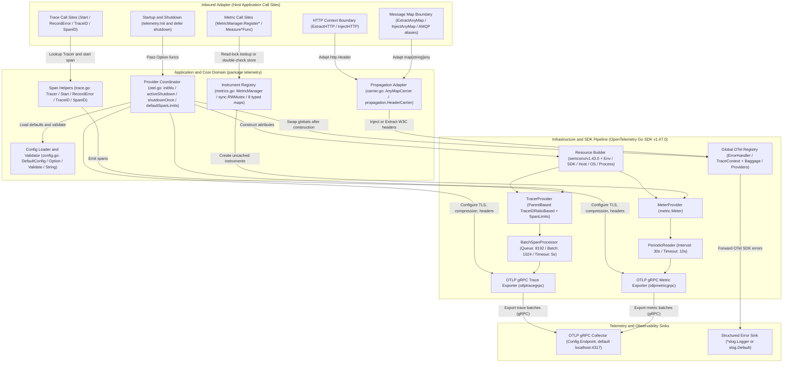
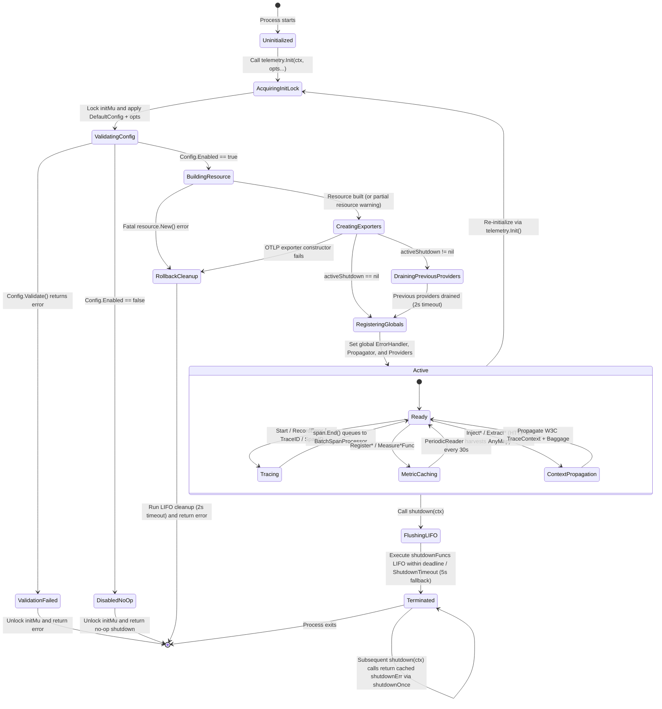
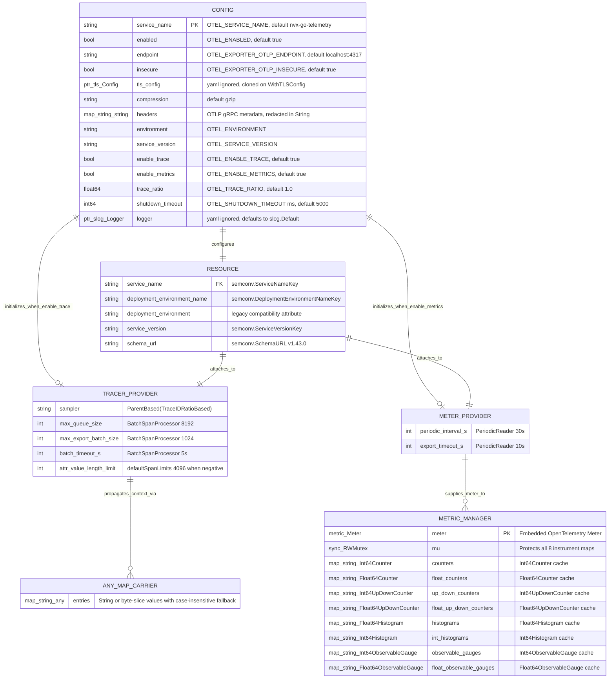

# nvx-go-telemetry

[](https://pkg.go.dev/github.com/Jkenyut/nvx-go-telemetry)
[](https://goreportcard.com/report/github.com/Jkenyut/nvx-go-telemetry)
[](LICENSE)
[](go.mod)
[](#verified-test-execution-output)

The `github.com/Jkenyut/nvx-go-telemetry/telemetry` Go package configures OpenTelemetry trace and metric providers with OTLP gRPC exporters (`go.opentelemetry.io/otel` `v1.47.0`). It validates runtime settings, caches metric instruments behind a read-write mutex, and exports span helpers for W3C context propagation across HTTP and `map[string]any` carriers. The library returns an idempotent shutdown callback that flushes buffered telemetry in reverse registration order.

---

## 1. Visual Architecture and Core Workflows

This section documents system boundaries, runtime call sequences, provider lifecycle states, and in-memory Go entity relationships verified directly against `telemetry/*.go`.

### 1.1 System Architecture



The host application initializes global OpenTelemetry providers through `telemetry.Init`, propagates `context.Context` across HTTP and message boundaries through `carrier.go`, records spans through `trace.go`, and registers cached metric instruments through `MetricManager`.

---

### 1.2 Core Workflows

#### Workflow A: Provider Initialization, Re-initialization, and Graceful Shutdown (`telemetry/otel.go`, `telemetry/config.go`)

```mermaid
sequenceDiagram
    autonumber
    actor App as Host Application
    participant Init as telemetry.Init()
    participant Cfg as Config (config.go)
    participant Res as resource.New()
    participant TraceExp as otlptracegrpc + BSP
    participant MetricExp as otlpmetricgrpc + PR
    participant Prev as activeShutdown
    participant Global as otel Globals
    participant Collector as OTLP gRPC Collector

    App->>Init: Init(ctx, opts...)
    Note over Init: Lock initMu; replace nil ctx with context.Background()
    Init->>Cfg: DefaultConfig() + apply non-nil opts...
    Init->>Cfg: Validate()

    alt Validation fails
        Cfg-->>Init: Return wrapped sentinel error
        Init-->>App: Return nil, error
    else Config.Enabled == false
        Cfg-->>Init: Return nil
        Init-->>App: Return no-op shutdown func, nil
    else Valid and Enabled
        Init->>Res: Build resource (SchemaURL, Env, SDK, Host, OS, Process, attrs)
        opt errors.Is(err, resource.ErrPartialResource)
            Res-->>Init: Log warning and continue with partial resource
        end
        alt Fatal resource error
            Init->>Init: cleanup() (2s timeout)
            Init-->>App: Return nil, error
        end

        opt Config.EnableTrace == true
            Init->>TraceExp: otlptracegrpc.New() + BatchSpanProcessor(8192, 1024, 5s) + TracerProvider
            alt Exporter creation fails
                Init->>Init: cleanup() (2s timeout)
                Init-->>App: Return nil, error
            end
        end

        opt Config.EnableMetrics == true
            Init->>MetricExp: otlpmetricgrpc.New() + PeriodicReader(30s, 10s) + MeterProvider
            alt Exporter creation fails
                Init->>Init: cleanup() (2s timeout)
                Init-->>App: Return nil, error
            end
        end

        opt activeShutdown != nil (re-initialization)
            Init->>Prev: Call previous shutdown with 2s timeout
            Prev-->>Init: Log warning if non-nil error
        end

        Init->>Global: SetErrorHandler + SetTextMapPropagator(TraceContext, Baggage)
        Init->>Global: SetTracerProvider + SetMeterProvider
        Note over Init: Store shutdown in activeShutdown; unlock initMu
        Init-->>App: Return idempotent shutdown func, nil
    end

    App->>App: Execute deferred shutdown(ctx)
    Note over App: Guard with shutdownOnce; use ctx deadline or cfg.ShutdownTimeout (fallback 5s)
    loop Reverse shutdownFuncs order (LIFO)
        App->>MetricExp: meterProvider.Shutdown(shutdownCtx)
        MetricExp->>Collector: Flush periodic metrics via gRPC
        App->>TraceExp: tracerProvider.Shutdown(shutdownCtx)
        TraceExp->>Collector: Flush queued spans via gRPC
    end
    App-->>App: Return errors.Join(errs...)
```

#### Workflow B: Distributed Context Propagation and Span Execution (`telemetry/carrier.go`, `telemetry/trace.go`)

```mermaid
sequenceDiagram
    autonumber
    actor Caller as Application Boundary
    participant Carrier as carrier.go
    participant Prop as Global TextMapPropagator
    participant Trace as trace.go
    participant Span as trace.Span

    alt HTTP inbound request
        Caller->>Carrier: ExtractHTTP(ctx, req.Header)
        Carrier->>Prop: Extract(ctx, HeaderCarrier(header))
    else Message broker inbound map
        Caller->>Carrier: ExtractAnyMap(ctx, headersMap)
        Carrier->>Prop: Extract(ctx, AnyMapCarrier(headersMap))
        alt Exact key lookup matches string or []byte
            Prop-->>Carrier: Read value directly
        else Exact lookup misses
            Note over Carrier: Scan map with strings.EqualFold(k, key)
            Prop-->>Carrier: Read case-insensitive string or []byte (or "")
        end
    end
    Prop-->>Caller: Return context with extracted SpanContext

    Caller->>Trace: Start(ctx, tracerName, spanName, opts...)
    Note over Trace: Fallback nil ctx -> Background; empty tracerName -> "unknown-tracer"
    Trace-->>Caller: Return childCtx, span
    Caller->>Trace: TraceID(childCtx) / SpanID(childCtx)
    Trace-->>Caller: Return 32-hex TraceID / 16-hex SpanID

    alt Operation fails
        Caller->>Trace: RecordError(span, err)
        Trace->>Span: span.RecordError(err) + span.SetStatus(codes.Error, err.Error())
        Caller->>Span: span.End()
    else Operation succeeds
        Caller->>Span: span.End()
    end

    opt Propagate outbound context
        Caller->>Carrier: InjectHTTP(childCtx, outReq.Header) or InjectAnyMap(childCtx, outMap)
        Note over Carrier: InjectAnyMap allocates map[string]any if carrier is nil
        Carrier->>Prop: Inject(childCtx, carrier)
    end
```

#### Workflow C: Thread-Safe Metric Instrument Caching (`telemetry/metrics.go`)

```mermaid
sequenceDiagram
    autonumber
    actor Caller as Service Caller
    participant MM as MetricManager
    participant Cache as Typed Map + sync.RWMutex
    participant Meter as metric.Meter

    Caller->>MM: Register*(name, ...) or Measure*Func(name, ...)
    MM->>MM: validate(name)

    alt m == nil or m.Meter == nil
        MM-->>Caller: Return ErrUninitializedManager
    else strings.TrimSpace(name) == ""
        MM-->>Caller: Return ErrEmptyMetricName
    else Valid manager and name
        MM->>Cache: RLock() and lookup (*cache)[name]
        alt Cache hit
            Cache-->>MM: Found existing instrument
            Note over MM: RUnlock()
            MM-->>Caller: Return cached instrument, nil
        else Cache miss
            Cache-->>MM: Not found
            Note over MM: RUnlock() before invoking Meter
            MM->>Meter: Create instrument outside lock
            alt Meter returns error
                Meter-->>MM: Return error
                MM-->>Caller: Return zero value, wrapped error
            else Instrument created
                Meter-->>MM: Return inst
                MM->>Cache: Lock()
                Note over Cache: Initialize map if nil; re-check (*cache)[name]
                alt Populated concurrently by another goroutine
                    Cache-->>MM: Return existing instrument
                else Slot still empty
                    Note over Cache: (*cache)[name] = inst
                end
                Note over MM: Unlock()
                MM-->>Caller: Return instrument, nil
            end
        end
    end
```

---

### 1.3 Provider Lifecycle and State Machine



---

### 1.4 Runtime Domain Entity Model

> [!NOTE]
> This repository is a stateless Go SDK library (`package telemetry`) and contains no SQL database, ORM schemas, or `migrations/` directory. The diagram below maps the Go structs and OpenTelemetry SDK runtime bindings verified in [`telemetry/config.go`](telemetry/config.go), [`telemetry/otel.go`](telemetry/otel.go), [`telemetry/metrics.go`](telemetry/metrics.go), and [`telemetry/carrier.go`](telemetry/carrier.go).



---

## 2. Deep Engineering and Concurrency Trade-Offs

### 2.1 Preventing Silent Span Attribute Drops in `defaultSpanLimits()`

In `go.opentelemetry.io/otel/sdk` `v1.47.0`, passing a zero-initialized `sdktrace.SpanLimits{}` to `sdktrace.WithRawSpanLimits` sets `AttributeCountLimit`, `EventCountLimit`, and `LinkCountLimit` to `0`, which drops all span attributes, events, and links. To prevent silent data loss while bounding memory on unbounded string/byte values, [`defaultSpanLimits`](telemetry/otel.go#L246-L254) initializes from `sdktrace.NewSpanLimits()` (preserving `128` count limits, depth `64`, and `OTEL_SPAN_*` environment overrides) and sets `AttributeValueLengthLimit` to `4096` only when negative (unlimited):

```go
const defaultAttributeValueLengthLimit = 4096

func defaultSpanLimits() sdktrace.SpanLimits {
	limits := sdktrace.NewSpanLimits()
	if limits.AttributeValueLengthLimit < 0 {
		limits.AttributeValueLengthLimit = defaultAttributeValueLengthLimit
	}
	return limits
}
```

---

### 2.2 Lock-Free Creation with Double-Checked Locking in `MetricManager`

[`getOrRegisterInstrument`](telemetry/metrics.go#L68-L100) caches instruments across 8 typed maps without holding `m.mu` during OpenTelemetry `metric.Meter` calls. It takes an `RLock` for the fast hit path, releases the read lock before calling `create()`, lazily initializes the map if `nil`, and acquires `m.mu.Lock()` to re-check the key so concurrent callers always receive the same instrument pointer:

```go
func getOrRegisterInstrument[T any](
	m *MetricManager,
	name string,
	kind string,
	cache *map[string]T,
	create func() (T, error),
) (T, error) {
	var zero T
	m.mu.RLock()
	if inst, ok := (*cache)[name]; ok {
		m.mu.RUnlock()
		return inst, nil
	}
	m.mu.RUnlock()

	inst, err := create()
	if err != nil {
		return zero, fmt.Errorf("registering %s %q: %w", kind, name, err)
	}

	m.mu.Lock()
	if *cache == nil {
		*cache = make(map[string]T)
	}
	if existing, ok := (*cache)[name]; ok {
		m.mu.Unlock()
		return existing, nil
	}
	(*cache)[name] = inst
	m.mu.Unlock()

	return inst, nil
}
```

---

### 2.3 Leak-Free Re-initialization, Rollback Cleanup, and Idempotent LIFO Shutdown

[`Init`](telemetry/otel.go#L30-L244) serializes provider lifecycle transitions under `initMu`. If resource construction or exporter setup fails mid-way, [`cleanup`](telemetry/otel.go#L61-L69) shuts down already-created providers in reverse order with a 2-second timeout. Before swapping global OTel handlers, `Init` drains any previously registered `activeShutdown` for up to 2 seconds to prevent goroutine leaks. The returned `shutdown` closure executes once via `sync.Once`, preserves caller deadlines (or falls back to `cfg.ShutdownTimeout` / `5s`), shuts down providers in LIFO order (`MeterProvider` before `TracerProvider`), and combines errors with `errors.Join`:

```go
	// Shut down any previously registered providers before swapping globals to prevent goroutine leaks.
	if activeShutdown != nil {
		prevCtx, prevCancel := context.WithTimeout(context.Background(), 2*time.Second)
		if prevErr := activeShutdown(prevCtx); prevErr != nil {
			logger.Warn("previous telemetry provider shutdown warning", "error", prevErr)
		}
		prevCancel()
	}
```

```go
	shutdown := func(ctx context.Context) error {
		shutdownOnce.Do(func() {
			if ctx == nil {
				ctx = context.Background()
			}

			timeout := time.Duration(cfg.ShutdownTimeout) * time.Millisecond
			if timeout <= 0 {
				timeout = 5 * time.Second
			}

			shutdownCtx := ctx
			var cancel context.CancelFunc
			if _, hasDeadline := ctx.Deadline(); !hasDeadline {
				shutdownCtx, cancel = context.WithTimeout(ctx, timeout)
				defer cancel()
			}

			var errs []error
			for i := len(shutdownFuncs) - 1; i >= 0; i-- {
				if err := shutdownFuncs[i](shutdownCtx); err != nil {
					errs = append(errs, err)
				}
			}
			shutdownErr = errors.Join(errs...)
		})
		return shutdownErr
	}
```

---

### 2.4 Defensive Cloning and Secret Redaction

[`WithHeaders`](telemetry/config.go#L127-L131), [`WithTLSConfig`](telemetry/config.go#L107-L116), and [`WithConfig`](telemetry/config.go#L156-L178) clone `Headers` maps (`maps.Clone`) and `*tls.Config` structs (`tlsCfg.Clone()`) to prevent caller mutations from causing data races after initialization. Setting a non-nil `tls.Config` via `WithTLSConfig` automatically forces `Insecure = false`. Both [`(*Config).String`](telemetry/config.go#L268-L278) and [`(*Config).GoString`](telemetry/config.go#L281-L283) mask every header value with `"[REDACTED]"`:

```go
func WithTLSConfig(tlsCfg *tls.Config) Option {
	return func(c *Config) {
		if tlsCfg != nil {
			c.TLSConfig = tlsCfg.Clone()
			c.Insecure = false
			return
		}
		c.TLSConfig = nil
	}
}
```

```go
func (c *Config) String() string {
	if c == nil {
		return "<nil>"
	}
	redactedHeaders := make(map[string]string, len(c.Headers))
	for k := range c.Headers {
		redactedHeaders[k] = "[REDACTED]"
	}
	return fmt.Sprintf("Config{Enabled:%t, Endpoint:%q, Insecure:%t, TLSConfigured:%t, Compression:%q, ServiceName:%q, Environment:%q, ServiceVersion:%q, EnableTrace:%t, EnableMetrics:%t, TraceRatio:%.2f, ShutdownTimeout:%dms, Headers:%v}",
		c.Enabled, c.Endpoint, c.Insecure, c.TLSConfig != nil, c.Compression, c.ServiceName, c.Environment, c.ServiceVersion, c.EnableTrace, c.EnableMetrics, c.TraceRatio, c.ShutdownTimeout, redactedHeaders)
}
```

---

### 2.5 Dual-Key Environment Attributes and Partial Resource Tolerance

When `cfg.Environment` is non-empty, [`Init`](telemetry/otel.go#L73-L99) emits both `semconv.DeploymentEnvironmentNameKey` (`deployment.environment.name`) and the legacy `deployment.environment` attribute so downstream collectors on older semantic conventions receive the environment tag. If `resource.New` returns `resource.ErrPartialResource` (for example, when host or OS metadata fails in a restricted container), `Init` logs a warning and continues instead of failing startup.

---

### 2.6 Two-Tier Case-Insensitive and Byte-Slice Carrier Resolution

Message brokers such as RabbitMQ store header tables as `map[string]any` where keys may vary in casing (`Traceparent`, `TRACEPARENT`) and values may arrive as `[]byte` rather than `string`. [`AnyMapCarrier.Get`](telemetry/carrier.go#L18-L43) attempts an O(1) exact map lookup first and falls back to `strings.EqualFold`, decoding both `string` and `[]byte` values while ignoring non-string/non-byte entries:

```go
func (c AnyMapCarrier) Get(key string) string {
	if c == nil {
		return ""
	}
	// 1. Direct exact lookup
	if val, ok := c[key]; ok && val != nil {
		if str, ok := val.(string); ok {
			return str
		}
		if b, ok := val.([]byte); ok {
			return string(b)
		}
	}
	// 2. Case-insensitive fallback for messaging headers (e.g. Traceparent)
	for k, val := range c {
		if strings.EqualFold(k, key) && val != nil {
			if str, ok := val.(string); ok {
				return str
			}
			if b, ok := val.([]byte); ok {
				return string(b)
			}
		}
	}
	return ""
}
```

---

## 3. Source-Verified Reference Catalogs

### 3.1 Metric Instrument and Telemetry Pipeline Catalog

> [!NOTE]
> `nvx-go-telemetry` provides a reusable metric wrapper (`MetricManager`) rather than hardcoded application business metrics. The tables below catalog every supported instrument factory method and every hardcoded SDK resource/pipeline setting verified in [`telemetry/metrics.go`](telemetry/metrics.go) and [`telemetry/otel.go`](telemetry/otel.go).

#### Table A: `MetricManager` Supported Instruments (`telemetry/metrics.go`)

| Method | Instrument Type | Unit Handling | Cache Map Field | Description (ASD-STE100) |
| :--- | :--- | :--- | :--- | :--- |
| `RegisterCounter` | `metric.Int64Counter` | Optional via `metric.WithUnit` | `counters` | Registers or retrieves a cached 64-bit integer monotonic counter. |
| `RegisterFloat64Counter` | `metric.Float64Counter` | Optional via `metric.WithUnit` | `floatCounters` | Registers or retrieves a cached 64-bit float monotonic counter. |
| `RegisterUpDownCounter` | `metric.Int64UpDownCounter` | Optional via `metric.WithUnit` | `upDownCounters` | Registers or retrieves a cached 64-bit integer bidirectional counter. |
| `RegisterFloat64UpDownCounter` | `metric.Float64UpDownCounter` | Optional via `metric.WithUnit` | `floatUpDownCounters` | Registers or retrieves a cached 64-bit float bidirectional counter. |
| `RegisterHistogram` | `metric.Float64Histogram` | `unit` parameter (`metric.WithUnit`) | `histograms` | Registers or retrieves a cached 64-bit float distribution histogram. |
| `RegisterInt64Histogram` | `metric.Int64Histogram` | `unit` parameter (`metric.WithUnit`) | `intHistograms` | Registers or retrieves a cached 64-bit integer distribution histogram. |
| `MeasureFunc` | `metric.Int64ObservableGauge` | Optional via `metric.WithUnit` | `observableGauges` | Registers or retrieves a cached asynchronous 64-bit integer gauge with callback. |
| `MeasureFloat64Func` | `metric.Float64ObservableGauge` | Optional via `metric.WithUnit` | `floatObservableGauges` | Registers or retrieves a cached asynchronous 64-bit float gauge with callback. |

#### Table B: Emitted Resource Attributes and SDK Pipeline Parameters (`telemetry/otel.go`)

| Key or Parameter | Source Location | Value or Rule | Description (ASD-STE100) |
| :--- | :--- | :--- | :--- |
| `service.name` | `otel.go:72` | `cfg.ServiceName` (`semconv.ServiceNameKey`) | Identifies the logical service name on all exported spans and metrics. |
| `deployment.environment.name` | `otel.go:75` | `cfg.Environment` (when non-empty) | Sets the OpenTelemetry `v1.43.0` deployment environment attribute. |
| `deployment.environment` | `otel.go:76` | `cfg.Environment` (when non-empty) | Emits the legacy deployment environment attribute for collector compatibility. |
| `service.version` | `otel.go:80` | `cfg.ServiceVersion` (when non-empty) | Sets the semantic service version attribute on the OTel resource. |
| Schema and Detectors | `otel.go:84-90` | `semconv.SchemaURL`, `WithFromEnv`, `WithTelemetrySDK`, `WithHost`, `WithOS`, `WithProcess` | Attaches host, OS, process, SDK, and `OTEL_RESOURCE_ATTRIBUTES` metadata. |
| `BatchSpanProcessor` | `otel.go:135-140` | Queue `8192`, Batch `1024`, Timeout `5s` | Buffers ended spans and exports batches to `otlptracegrpc`. |
| Trace Sampler | `otel.go:143` | `ParentBased(TraceIDRatioBased(cfg.TraceRatio))` | Respects upstream parent sampling decisions and samples root spans by ratio. |
| `defaultSpanLimits()` | `otel.go:246-254` | `AttributeValueLengthLimit = 4096` (if `< 0`) | Caps unbounded attribute values while preserving SDK count limits (`128`) and depth (`64`). |
| `PeriodicReader` | `otel.go:172-176` | Interval `30s`, Timeout `10s` | Collects aggregated metric points and exports batches to `otlpmetricgrpc`. |

---

### 3.2 Header, Context Propagation, and OTLP Metadata Contract

> [!NOTE]
> This repository implements a Go SDK library and contains no HTTP router or API gateway middleware. The table below documents the W3C propagation headers and OTLP gRPC metadata handled by [`telemetry/carrier.go`](telemetry/carrier.go) and [`telemetry/otel.go`](telemetry/otel.go).

| Header / Metadata Key | Required | Origin / Context | Functional Role (ASD-STE100) |
| :--- | :--- | :--- | :--- |
| `traceparent` | No (optional) | W3C `TraceContext` via `ExtractHTTP`, `InjectHTTP`, `ExtractAnyMap`, `InjectAnyMap` | Propagates trace ID, parent span ID, and sampling flags; `AnyMapCarrier.Get` supports exact and case-insensitive `string`/`[]byte` lookup. |
| `tracestate` | No (optional) | W3C `TraceContext` via global composite propagator | Carries vendor-specific trace state across HTTP headers and message maps. |
| `baggage` | No (optional) | W3C `Baggage` via global composite propagator | Propagates key-value baggage items across service boundaries. |
| User-defined `Config.Headers` keys | No (optional) | OTLP gRPC exporters (`otlptracegrpc.WithHeaders`, `otlpmetricgrpc.WithHeaders`) | Sends authentication tokens or API keys to the collector; `String()` and `GoString()` mask all values as `[REDACTED]`. |

---

### 3.3 Configuration and Environment Matrix

> [!NOTE]
> This repository contains no `.env` or `config.template.yaml` file. All parameters below cross-check directly against the `Config` struct tags, `DefaultConfig()`, `applyEnv()`, and `Validate()` in [`telemetry/config.go`](telemetry/config.go), plus OpenTelemetry SDK `v1.47.0` defaults in `otel.go` and `span_limits.go`.

#### Table A: `telemetry.Config` Fields and Environment Overrides (`telemetry/config.go`)

| Environment Variable | Config YAML Key | Go Field (`Type`) | Default Value | Description (ASD-STE100) |
| :--- | :--- | :--- | :--- | :--- |
| `OTEL_ENABLED` | `enabled` | `Enabled` (`bool`) | `true` | Enables or disables OpenTelemetry provider initialization (`strconv.ParseBool`). |
| `OTEL_EXPORTER_OTLP_ENDPOINT` | `endpoint` | `Endpoint` (`string`) | `"localhost:4317"` | Sets the OTLP gRPC target host and port; `Validate` rejects empty values or `://` URL schemes. |
| `OTEL_EXPORTER_OTLP_INSECURE` | `insecure` | `Insecure` (`bool`) | `true` | Disables TLS on OTLP gRPC transport; setting `false` uses `TLSConfig` or system root CAs. |
| `N/A` | `yaml:"-"` (excluded) | `TLSConfig` (`*tls.Config`) | `nil` | Supplies custom TLS credentials; `WithTLSConfig` clones non-nil configs and sets `Insecure = false`. |
| `N/A` | `compression` | `Compression` (`string`) | `"gzip"` | Sets OTLP gRPC compressor (`"gzip"` or `"none"`; empty string or `"none"` disables compression). |
| `N/A` | `headers` | `Headers` (`map[string]string`) | `nil` | Supplies OTLP gRPC authentication metadata; `WithHeaders` clones the map and `String` redacts values. |
| `OTEL_SERVICE_NAME` | `service_name` | `ServiceName` (`string`) | `"nvx-go-telemetry"` | Sets `service.name` on the OTel resource; `Validate` rejects empty or whitespace-only values when enabled. |
| `OTEL_ENVIRONMENT` | `environment` | `Environment` (`string`) | `""` | Sets `deployment.environment.name` and `deployment.environment` when non-empty. |
| `OTEL_SERVICE_VERSION` | `service_version` | `ServiceVersion` (`string`) | `""` | Sets `service.version` on the OTel resource when non-empty. |
| `OTEL_ENABLE_TRACE` | `enable_trace` | `EnableTrace` (`bool`) | `true` | Enables or disables `TracerProvider` and `otlptracegrpc` initialization. |
| `OTEL_ENABLE_METRICS` | `enable_metrics` | `EnableMetrics` (`bool`) | `true` | Enables or disables `MeterProvider` and `otlpmetricgrpc` initialization. |
| `OTEL_TRACE_RATIO` | `trace_ratio` | `TraceRatio` (`float64`) | `1.0` | Sets `TraceIDRatioBased` root sampling ratio; `Validate` requires `0.0 <= TraceRatio <= 1.0`. |
| `OTEL_SHUTDOWN_TIMEOUT` | `shutdown_timeout` | `ShutdownTimeout` (`int64`) | `5000` (ms) | Sets shutdown flush timeout in milliseconds; accepts integers (`"3500"`) or Go durations (`"7s"`), and `Validate` resets `<= 0` to `5000`. |
| `N/A` | `yaml:"-"` (excluded) | `Logger` (`*slog.Logger`) | `nil` (`slog.Default()`) | Sets the logger for `otel.SetErrorHandler` and initialization warnings. |

> [!TIP]
> `applyEnv` trims surrounding whitespace and ignores unset, empty, or unparseable environment values without failing `DefaultConfig()`. Callers supply YAML or struct values programmatically via `telemetry.WithConfig(&cfg)`.

#### Table B: Indirect OpenTelemetry SDK Environment Variables (`otel.go` / `sdktrace.NewSpanLimits`)

| Environment Variable | Reader Location | Default Value | Description (ASD-STE100) |
| :--- | :--- | :--- | :--- |
| `OTEL_RESOURCE_ATTRIBUTES` | `resource.WithFromEnv()` | Empty | Appends additional key-value attributes to the OTel resource from the process environment. |
| `OTEL_SPAN_ATTRIBUTE_VALUE_LENGTH_LIMIT` | `sdktrace.NewSpanLimits()` | `4096` (via `defaultSpanLimits`) | Sets max attribute value length; `defaultSpanLimits` overrides negative (`-1` unlimited) values to `4096`. |
| `OTEL_SPAN_ATTRIBUTE_COUNT_LIMIT` | `sdktrace.NewSpanLimits()` | `128` | Sets maximum attributes per span. |
| `OTEL_SPAN_EVENT_COUNT_LIMIT` | `sdktrace.NewSpanLimits()` | `128` | Sets maximum events per span. |
| `OTEL_EVENT_ATTRIBUTE_COUNT_LIMIT` | `sdktrace.NewSpanLimits()` | `128` | Sets maximum attributes per span event. |
| `OTEL_SPAN_LINK_COUNT_LIMIT` | `sdktrace.NewSpanLimits()` | `128` | Sets maximum links per span. |
| `OTEL_LINK_ATTRIBUTE_COUNT_LIMIT` | `sdktrace.NewSpanLimits()` | `128` | Sets maximum attributes per span link. |

---

### 3.4 Complete Public API Catalog (`package telemetry`)

> [!NOTE]
> This repository implements a Go library (`github.com/Jkenyut/nvx-go-telemetry/telemetry`) and defines no HTTP endpoints or RBAC guard constants. The tables below catalog every exported type, function, method, and sentinel error in `telemetry/*.go`, grouped by domain capability.

#### Lifecycle and Initialization (`telemetry/otel.go`)

| Symbol / Signature | Source | Guard / Validation | Description (ASD-STE100) |
| :--- | :--- | :--- | :--- |
| `Init(ctx context.Context, opts ...Option) (func(context.Context) error, error)` | `otel.go:30` | `initMu.Lock()`, `cfg.Validate()` | Initializes OTLP trace/metric providers, registers global propagators and error handler, drains prior providers, and returns an idempotent LIFO shutdown function. |

#### Configuration and Functional Options (`telemetry/config.go`)

| Symbol / Signature | Source | Guard / Behavior | Description (ASD-STE100) |
| :--- | :--- | :--- | :--- |
| `type Config struct` | `config.go:29` | YAML tags + `Validate()` | Stores telemetry, OTLP transport, resource, sampling, shutdown, and logger settings. |
| `type Option func(*Config)` | `config.go:47` | Non-nil check in `Init` | Mutates a `Config` instance during `Init`. |
| `DefaultConfig() *Config` | `config.go:214` | `OTEL_*` env parsing | Returns default `Config` overlaid with parsed `OTEL_*` environment variables. |
| `(*Config).Validate() error` | `config.go:242` | Nil & bounds checks | Validates non-nil config, non-empty scheme-free endpoint, non-empty service name, `0.0 <= TraceRatio <= 1.0`, and resets `ShutdownTimeout <= 0` to `5000`. |
| `(*Config).String() string` | `config.go:268` | Nil-safe | Formats `Config` as a string with all `Headers` values replaced by `"[REDACTED]"`. |
| `(*Config).GoString() string` | `config.go:281` | Nil-safe | Delegates to `String()` for `%#v` formatting with redacted headers. |
| `WithEnabled(enabled bool) Option` | `config.go:50` | None | Sets `Config.Enabled`. |
| `WithEndpoint(endpoint string) Option` | `config.go:57` | Validated in `Init` | Sets `Config.Endpoint` (`host:port` without scheme). |
| `WithServiceName(name string) Option` | `config.go:64` | Validated in `Init` | Sets `Config.ServiceName`. |
| `WithEnvironment(env string) Option` | `config.go:71` | None | Sets `Config.Environment`. |
| `WithServiceVersion(version string) Option` | `config.go:78` | None | Sets `Config.ServiceVersion`. |
| `WithTraceEnabled(enabled bool) Option` | `config.go:85` | None | Sets `Config.EnableTrace`. |
| `WithMetricsEnabled(enabled bool) Option` | `config.go:92` | None | Sets `Config.EnableMetrics`. |
| `WithInsecure(insecure bool) Option` | `config.go:99` | None | Sets `Config.Insecure`. |
| `WithTLSConfig(tlsCfg *tls.Config) Option` | `config.go:107` | Clones when non-nil | Clones `tlsCfg` into `Config.TLSConfig` and sets `Insecure = false`; clears `TLSConfig` when `nil`. |
| `WithCompression(compression string) Option` | `config.go:119` | None | Sets `Config.Compression` (`"gzip"` or `"none"`). |
| `WithHeaders(headers map[string]string) Option` | `config.go:127` | `maps.Clone` | Clones `headers` into `Config.Headers`. |
| `WithTraceRatio(ratio float64) Option` | `config.go:134` | Validated in `Init` | Sets `Config.TraceRatio`. |
| `WithShutdownTimeout(timeout int64) Option` | `config.go:141` | Reset to `5000` if `<= 0` | Sets `Config.ShutdownTimeout` in milliseconds. |
| `WithLogger(logger *slog.Logger) Option` | `config.go:148` | Fallback `slog.Default()` | Sets `Config.Logger`. |
| `WithConfig(src *Config) Option` | `config.go:156` | Nil-safe, clones TLS/headers | Copies all fields from `src`, cloning `TLSConfig` and `Headers` and preserving existing logger if `src.Logger == nil`. |

#### Distributed Tracing (`telemetry/trace.go`)

| Symbol / Signature | Source | Nil / Empty Safety | Description (ASD-STE100) |
| :--- | :--- | :--- | :--- |
| `Tracer(name string) trace.Tracer` | `trace.go:12` | Empty `name` -> `"unknown-tracer"` | Returns a named OpenTelemetry `trace.Tracer` from the global `TracerProvider`. |
| `Start(ctx context.Context, tracerName, spanName string, opts ...trace.SpanStartOption) (context.Context, trace.Span)` | `trace.go:22` | Nil `ctx` -> `context.Background()` | Starts and returns a child span and derived context. |
| `RecordError(span trace.Span, err error)` | `trace.go:32` | No-op if `span == nil` or `err == nil` | Records an error event on `span` and sets status to `codes.Error`. |
| `TraceID(ctx context.Context) string` | `trace.go:42` | Returns `""` if nil or no trace ID | Extracts the 32-character hexadecimal trace ID from `ctx`. |
| `SpanID(ctx context.Context) string` | `trace.go:55` | Returns `""` if nil or no span ID | Extracts the 16-character hexadecimal span ID from `ctx`. |

#### Context Propagation (`telemetry/carrier.go`)

| Symbol / Signature | Source | Nil / Edge Behavior | Description (ASD-STE100) |
| :--- | :--- | :--- | :--- |
| `type AnyMapCarrier map[string]any` | `carrier.go:14` | Nil-safe methods | Adapts `map[string]any` to OpenTelemetry `propagation.TextMapCarrier`. |
| `(AnyMapCarrier).Get(key string) string` | `carrier.go:18` | Nil-safe; `[]byte` decoded | Looks up exact key first, then falls back to `strings.EqualFold` for `string` or `[]byte` values. |
| `(AnyMapCarrier).Set(key string, val string)` | `carrier.go:46` | No-op on `nil` map | Writes `val` at `key` in the underlying map. |
| `(AnyMapCarrier).Keys() []string` | `carrier.go:54` | Returns `nil` on `nil` map | Returns all keys stored in the map. |
| `InjectHTTP(ctx context.Context, header http.Header)` | `carrier.go:66` | No-op if `ctx` or `header` is `nil` | Writes W3C trace context and baggage into `http.Header`. |
| `ExtractHTTP(ctx context.Context, header http.Header) context.Context` | `carrier.go:74` | Nil `ctx` -> `Background()` | Reads W3C trace context and baggage from `http.Header`. |
| `InjectHTTPHeader(ctx context.Context, header http.Header)` | `carrier.go:109` | Delegates to `InjectHTTP` | Provides a backward-compatible alias for `InjectHTTP`. |
| `ExtractHTTPHeader(ctx context.Context, header http.Header) context.Context` | `carrier.go:115` | Delegates to `ExtractHTTP` | Provides a backward-compatible alias for `ExtractHTTP`. |
| `InjectAnyMap(ctx context.Context, carrier map[string]any) map[string]any` | `carrier.go:85` | Allocates map if `nil` | Writes W3C trace context and baggage into `carrier` and returns the map. |
| `ExtractAnyMap(ctx context.Context, carrier map[string]any) context.Context` | `carrier.go:97` | Nil `ctx` -> `Background()` | Reads W3C trace context and baggage from `carrier`. |
| `InjectAMQP(ctx context.Context, carrier map[string]any) map[string]any` | `carrier.go:121` | Delegates to `InjectAnyMap` | Provides a RabbitMQ `amqp.Table`-oriented alias for `InjectAnyMap`. |
| `ExtractAMQP(ctx context.Context, carrier map[string]any) context.Context` | `carrier.go:127` | Delegates to `ExtractAnyMap` | Provides a RabbitMQ `amqp.Table`-oriented alias for `ExtractAnyMap`. |

#### Metric Management (`telemetry/metrics.go`)

| Symbol / Signature | Source | Guard / Validation | Description (ASD-STE100) |
| :--- | :--- | :--- | :--- |
| `type MetricManager struct` | `metrics.go:21` | Embeds `metric.Meter` | Caches OpenTelemetry metric instruments with thread-safe `sync.RWMutex` access. |
| `NewMetricManager(instrumentationName string) *MetricManager` | `metrics.go:35` | Empty name -> `"unknown-meter"` | Constructs a `MetricManager` backed by `otel.Meter(instrumentationName)`. |
| `NewMetricManagerWithMeter(meter metric.Meter) *MetricManager` | `metrics.go:44` | Allows DI without globals | Constructs a `MetricManager` using an explicit `metric.Meter`. |
| `(*MetricManager).RegisterCounter(name, description string, opts ...metric.Int64CounterOption) (metric.Int64Counter, error)` | `metrics.go:103` | `m.validate(name)` | Registers or returns a cached `metric.Int64Counter`. |
| `(*MetricManager).RegisterFloat64Counter(name, description string, opts ...metric.Float64CounterOption) (metric.Float64Counter, error)` | `metrics.go:118` | `m.validate(name)` | Registers or returns a cached `metric.Float64Counter`. |
| `(*MetricManager).RegisterUpDownCounter(name, description string, opts ...metric.Int64UpDownCounterOption) (metric.Int64UpDownCounter, error)` | `metrics.go:133` | `m.validate(name)` | Registers or returns a cached `metric.Int64UpDownCounter`. |
| `(*MetricManager).RegisterFloat64UpDownCounter(name, description string, opts ...metric.Float64UpDownCounterOption) (metric.Float64UpDownCounter, error)` | `metrics.go:148` | `m.validate(name)` | Registers or returns a cached `metric.Float64UpDownCounter`. |
| `(*MetricManager).RegisterHistogram(name, description, unit string, opts ...metric.Float64HistogramOption) (metric.Float64Histogram, error)` | `metrics.go:163` | `m.validate(name)` | Registers or returns a cached `metric.Float64Histogram`. |
| `(*MetricManager).RegisterInt64Histogram(name, description, unit string, opts ...metric.Int64HistogramOption) (metric.Int64Histogram, error)` | `metrics.go:181` | `m.validate(name)` | Registers or returns a cached `metric.Int64Histogram`. |
| `(*MetricManager).MeasureFunc(name, description string, callback metric.Int64Callback, opts ...metric.Int64ObservableGaugeOption) (metric.Int64ObservableGauge, error)` | `metrics.go:199` | `m.validate(name)` | Registers or returns a cached `metric.Int64ObservableGauge` with optional callback. |
| `(*MetricManager).MeasureFloat64Func(name, description string, callback metric.Float64Callback, opts ...metric.Float64ObservableGaugeOption) (metric.Float64ObservableGauge, error)` | `metrics.go:217` | `m.validate(name)` | Registers or returns a cached `metric.Float64ObservableGauge` with optional callback. |
| `(*MetricManager).GetMeter() metric.Meter` | `metrics.go:237` | Deprecated; nil-safe | Returns the embedded `metric.Meter` (deprecated: access `MetricManager.Meter` directly). |

#### Exported Sentinel Errors (`telemetry/config.go`, `telemetry/metrics.go`)

| Error Symbol | Exact Message | Source | Trigger Condition |
| :--- | :--- | :--- | :--- |
| `ErrNilConfig` | `"telemetry config is nil"` | `config.go:17` | Calling `Validate()` on a `nil` `*Config` pointer. |
| `ErrEmptyEndpoint` | `"telemetry endpoint cannot be empty when enabled"` | `config.go:19` | Calling `Init` or `Validate` with `Enabled: true` and blank `Endpoint`. |
| `ErrEndpointWithScheme` | `"telemetry endpoint must not contain a URL scheme"` | `config.go:21` | Providing `"://"` inside `Endpoint` (for example, `http://localhost:4317`). |
| `ErrEmptyServiceName` | `"telemetry service name cannot be empty when enabled"` | `config.go:23` | Calling `Init` or `Validate` with `Enabled: true` and blank `ServiceName`. |
| `ErrInvalidTraceRatio` | `"telemetry trace ratio must be between 0.0 and 1.0"` | `config.go:25` | Providing `TraceRatio < 0.0` or `TraceRatio > 1.0` when enabled. |
| `ErrUninitializedManager` | `"metric manager is uninitialized"` | `metrics.go:15` | Calling a registration method on a `nil` `*MetricManager` or `nil` embedded `Meter`. |
| `ErrEmptyMetricName` | `"metric name cannot be empty"` | `metrics.go:17` | Calling a registration method with an empty or whitespace-only metric name. |

#### Compilable Integration Example

```go
package main

import (
	"context"
	"errors"
	"log"
	"net/http"

	"github.com/Jkenyut/nvx-go-telemetry/telemetry"
)

func main() {
	ctx := context.Background()

	shutdown, err := telemetry.Init(ctx,
		telemetry.WithServiceName("billing-api"),
		telemetry.WithEnvironment("production"),
		telemetry.WithServiceVersion("v1.0.0"),
		telemetry.WithEndpoint("localhost:4317"),
		telemetry.WithInsecure(true),
		telemetry.WithTraceRatio(1.0),
		telemetry.WithShutdownTimeout(5000),
	)
	if err != nil {
		log.Fatalf("telemetry init failed: %v", err)
	}
	defer func() {
		if shutdownErr := shutdown(context.Background()); shutdownErr != nil {
			log.Printf("telemetry shutdown warning: %v", shutdownErr)
		}
	}()

	mm := telemetry.NewMetricManager("billing-api")
	requestsTotal, err := mm.RegisterCounter("requests_total", "Total handled HTTP requests")
	if err != nil {
		log.Fatalf("counter registration failed: %v", err)
	}

	http.HandleFunc("/events", func(w http.ResponseWriter, r *http.Request) {
		reqCtx := telemetry.ExtractHTTP(r.Context(), r.Header)
		spanCtx, span := telemetry.Start(reqCtx, "billing-api", "ingest_event")
		defer span.End()

		if r.Header.Get("X-Order-ID") == "" {
			validationErr := errors.New("missing X-Order-ID header")
			telemetry.RecordError(span, validationErr)
			http.Error(w, validationErr.Error(), http.StatusBadRequest)
			return
		}

		// Inject trace context into outbound message headers (e.g., AMQP table).
		outboundHeaders := telemetry.InjectAMQP(spanCtx, nil)
		_ = outboundHeaders

		requestsTotal.Add(spanCtx, 1)
		w.Header().Set("Content-Type", "application/json")
		w.WriteHeader(http.StatusAccepted)
		_, _ = w.Write([]byte(`{"trace_id":"` + telemetry.TraceID(spanCtx) + `"}`))
	})

	log.Fatal(http.ListenAndServe(":8080", nil))
}
```

---

### 3.5 Makefile, CI Pipeline, and Operational Runbook

#### Prerequisites

| Tool | Verified Version / Config | Source | Operational Role (ASD-STE100) |
| :--- | :--- | :--- | :--- |
| Go Toolchain | `1.27.3` | [`go.mod`](go.mod#L3) | Compiles `package telemetry` and runs unit tests, `go vet`, and coverage tools. |
| `golangci-lint` | Config `version: "2"` | [`.golangci.yml`](.golangci.yml#L1) | Executes static analyzers and formatters (`gofumpt`, `gofmt`, `goimports`) when installed locally. |
| OTLP gRPC Collector (Optional) | Port `4317` (default endpoint) | [`telemetry/config.go`](telemetry/config.go#L217) | Receives exported OTLP gRPC traces and metrics during local end-to-end testing. |

#### Step-by-Step Local Bootstrap and Verification Runbook

1. Add the module to a Go project (or clone this repository for local development):
   ```bash
   go get github.com/Jkenyut/nvx-go-telemetry
   ```
2. Verify module checksums against `go.sum`:
   ```bash
   go mod verify
   ```
3. Run the unit test suite with the Go race detector enabled:
   ```bash
   make test-race
   ```
4. Measure statement coverage across all packages:
   ```bash
   make test-cover
   ```
5. Run static analysis (`go vet ./...` and `golangci-lint run ./...` if available):
   ```bash
   make lint
   ```
6. Remove build caches and `coverage.out` artifacts:
   ```bash
   make clean
   ```

#### Makefile Target Reference ([`Makefile`](Makefile))

| Target | Exact Command | Description (ASD-STE100) |
| :--- | :--- | :--- |
| `help` | `@grep -E '^[a-zA-Z_-]+:.*?## .*$$' $(MAKEFILE_LIST) \| sort \| ...` | Prints all documented `Makefile` targets and descriptions. |
| `test` | `go test -v ./...` | Runs all unit tests with verbose output. |
| `test-race` | `go test -v -race ./...` | Runs all unit tests with the Go race detector enabled. |
| `test-cover` | `go test -v -cover ./...` | Runs all unit tests and prints package statement coverage. |
| `lint` | `go vet ./...` and `golangci-lint run ./...` (if installed) | Runs `go vet` and invokes `golangci-lint` v2 when present on `$PATH`. |
| `clean` | `go clean` and `rm -f coverage.out` | Clears Go build cache artifacts and removes `coverage.out`. |

#### CI Quality Gates ([`.github/workflows/ci.yml`](.github/workflows/ci.yml) and [`.golangci.yml`](.golangci.yml))

- **CI Triggers**: Executes `Test and Lint` on `ubuntu-latest` for `push` and `pull_request` events targeting `main` and `development`.
- **CI Steps**: Checks out code, configures Go from `go.mod`, runs `go mod verify`, enforces `test -z "$(gofmt -l .)"`, runs `go vet ./...`, executes `go test -v -race -coverprofile=coverage.out ./...`, and prints function coverage via `go tool cover -func=coverage.out`.
- **Enabled `golangci-lint` v2 Analyzers**: `errcheck`, `govet` (with `shadow`), `staticcheck`, `errorlint`, `errname`, `nilerr`, `revive` (`receiver-naming`, `error-naming`, `error-strings`, `exported`, `time-naming`, `unexported-return`, `empty-block`, `context-as-argument`, `indent-error-flow`), `gocritic` (`performance`, `style`, `experimental`, excluding `wrapperFunc`), `bodyclose`, `prealloc`, `ineffassign`, `unused`, and `whitespace`.
- **Enabled Formatters**: `gofumpt` (`extra.group-params: true`), `gofmt`, and `goimports`.

#### Verified Test Execution Output

Command executed against the current repository state: `go test -v -race -cover ./...`

- **Result**: `PASS` (`17 passed` in `github.com/Jkenyut/nvx-go-telemetry/telemetry`, `93.7%` statement coverage).
- **Executed Tests**:
  - [`telemetry/carrier_test.go`](telemetry/carrier_test.go): `TestCarrierHTTPAndAnyMap`
  - [`telemetry/otel_test.go`](telemetry/otel_test.go): `TestInit_Disabled`, `TestInit_InvalidConfig`, `TestInit_Idempotency`, `TestInit_FallbackLogger`, `TestConfig_Defaults_And_Options`, `TestConfig_Headers_CloneSafety`, `TestConfig_Masking`, `TestTrace_Operations`, `TestMetrics_Operations`, `TestConfig_WithConfig`, `TestInit_Concurrent`, `TestConfig_EnvOverrides`, `TestConfig_TLSAndCompression`, `TestInit_ReinitializationShutdown`, `TestMetrics_EndToEnd_WithManualReader`, `TestDefaultSpanLimits_PreservesAttributeValues`

> [!NOTE]
> `TestConfig_TLSAndCompression` and `TestInit_ReinitializationShutdown` intentionally exercise live OTLP gRPC shutdown paths against `localhost:4317`; when no local collector runs during unit testing, the SDK logs an expected `connection refused` warning and passes within the configured timeout.

#### Troubleshooting and Fault Isolation

| Symptom / Error | Verified Root Cause | Corrective Action |
| :--- | :--- | :--- |
| `telemetry config is nil` (`ErrNilConfig`) | Caller passed a `nil` `*Config` to `Validate()`. | Construct settings via `DefaultConfig()` or `telemetry.Init(ctx, opts...)`. |
| `telemetry endpoint cannot be empty when enabled` (`ErrEmptyEndpoint`) | `Endpoint` is empty or whitespace while `Enabled` is `true`. | Pass `WithEndpoint("host:port")` or set `OTEL_EXPORTER_OTLP_ENDPOINT`. |
| `telemetry endpoint must not contain a URL scheme` (`ErrEndpointWithScheme`) | `Endpoint` contains `"://"` (such as `http://localhost:4317`). | Remove the URL scheme and pass only `host:port`. |
| `telemetry service name cannot be empty when enabled` (`ErrEmptyServiceName`) | `ServiceName` is empty or whitespace while `Enabled` is `true`. | Pass `WithServiceName("my-service")` or set `OTEL_SERVICE_NAME`. |
| `telemetry trace ratio must be between 0.0 and 1.0` (`ErrInvalidTraceRatio`) | `TraceRatio` is below `0.0` or above `1.0`. | Pass a `WithTraceRatio` value between `0.0` and `1.0`. |
| `metric manager is uninitialized` (`ErrUninitializedManager`) | Caller invoked `MetricManager` on a `nil` pointer or `nil` `Meter`. | Instantiate with `NewMetricManager(name)` or `NewMetricManagerWithMeter(meter)`. |
| `metric name cannot be empty` (`ErrEmptyMetricName`) | Caller passed an empty or whitespace-only instrument name. | Pass a non-empty metric instrument name. |
| `connection error ... dial tcp ...:4317: connect: connection refused` on shutdown | No OTLP gRPC collector listens on `Config.Endpoint`. | Start an OTLP gRPC collector on the configured port or disable telemetry in offline tests. |
| Buffered spans or metrics missing on process exit | Application exited without invoking the `shutdown(ctx)` callback. | Always `defer shutdown(context.Background())` immediately after `telemetry.Init`. |

---

### 3.6 Annotated Repository Directory Tree

```text
.
├── .github/
│   └── workflows/
│       └── ci.yml                 # Runs go mod verify, gofmt, go vet, race tests, and coverage checks on CI.
├── docs/
│   ├── architecture/
│   │   └── sequences.md           # Documents extended architecture and sequence diagrams.
│   └── modules/
│       ├── carrier.md             # Documents HTTP and AnyMap context propagation adapters.
│       ├── configuration.md       # Documents Config struct fields, options, and validation states.
│       ├── metrics.md             # Documents MetricManager caching and observable callbacks.
│       └── tracing.md             # Documents span creation, TraceID/SpanID helpers, and error capture.
├── telemetry/
│   ├── carrier.go                 # Implements AnyMapCarrier, HTTP/AnyMap propagation, and AMQP aliases.
│   ├── carrier_test.go            # Verifies W3C propagation, byte-slice decoding, and nil safety.
│   ├── config.go                  # Defines Config, Option setters, OTEL_* env loader, Validate, and String redaction.
│   ├── metrics.go                 # Implements MetricManager with double-checked RWMutex instrument caching.
│   ├── otel.go                    # Coordinates Init, resource construction, OTLP gRPC exporters, and LIFO shutdown.
│   ├── otel_test.go               # Verifies lifecycle, concurrency, TLS, compression, span limits, and metrics e2e.
│   └── trace.go                   # Implements Tracer, Start, RecordError, TraceID, and SpanID helpers.
├── .gitignore                     # Excludes binaries, coverage profiles, .env files, and IDE/agent artifacts.
├── .golangci.yml                  # Configures golangci-lint v2 analyzers and gofumpt/gofmt/goimports formatters.
├── CONTRIBUTING.md                # Defines branching strategy (main/development) and pull request steps.
├── LICENSE                        # Contains the Apache License 2.0 legal text.
├── Makefile                       # Defines help, test, test-race, test-cover, lint, and clean targets.
├── README.md                      # Documents system architecture, engineering trade-offs, and verified catalogs.
├── go.mod                         # Declares module github.com/Jkenyut/nvx-go-telemetry on Go 1.27.3.
└── go.sum                         # Stores cryptographic dependency checksums.
```

Additional module documentation resides in:
- [System Architecture and Sequences](docs/architecture/sequences.md)
- [Configuration and Lifecycle Guide](docs/modules/configuration.md)
- [Context Propagation Guide](docs/modules/carrier.md)
- [Distributed Tracing Guide](docs/modules/tracing.md)
- [Metrics Management Guide](docs/modules/metrics.md)

---

## 4. License

This project uses the Apache License 2.0. Read [LICENSE](LICENSE) for full terms and conditions.
