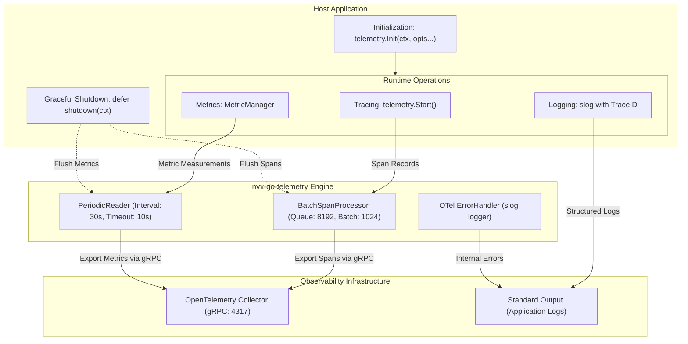
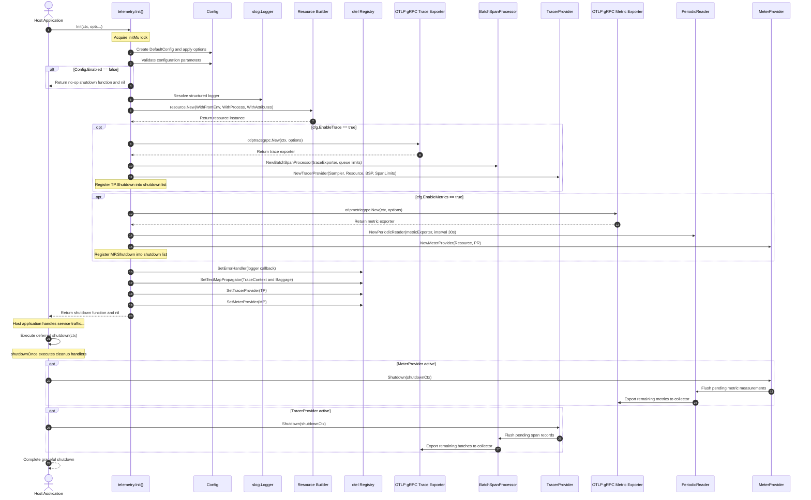
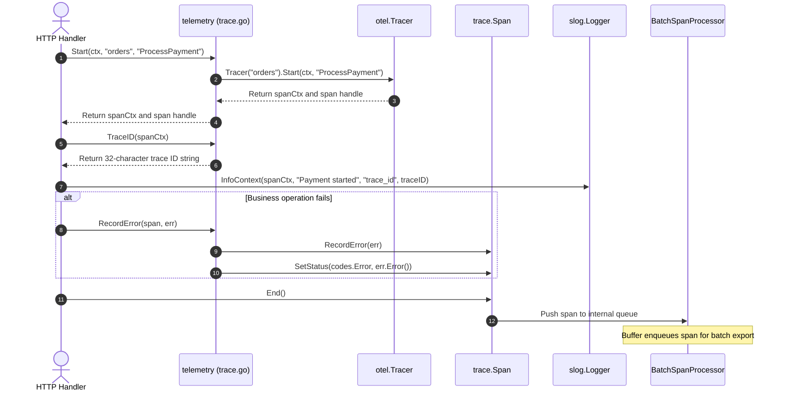
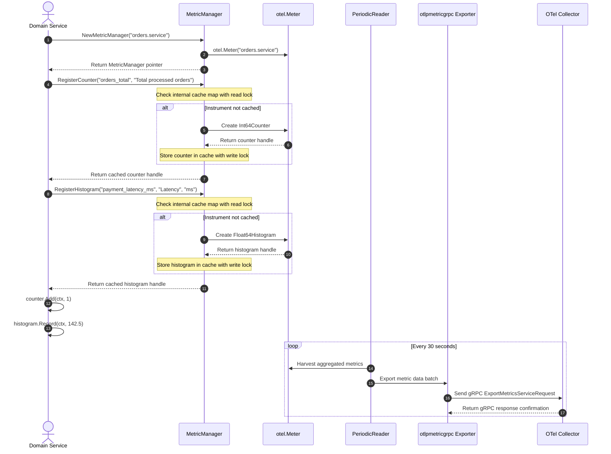
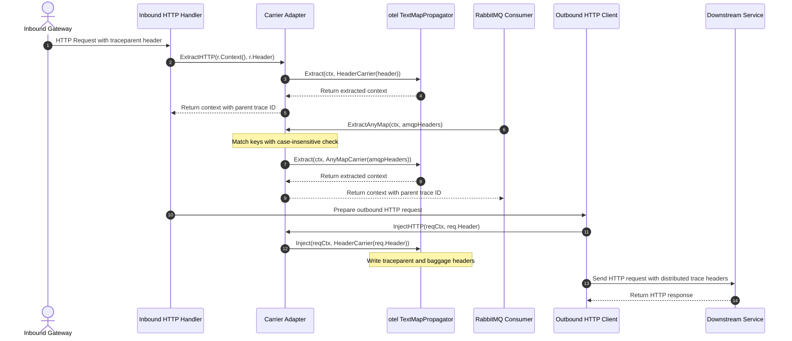

# Architecture and Sequence Workflows

This document describes the software architecture and operational workflows for [`nvx-go-telemetry`](../../telemetry).

---

## 1. High-Level System Architecture

The diagram below shows the data flow between the host application, internal memory buffers, and observability collectors.

The host application configures providers during process startup. The trace helper forwards completed spans to the batch span processor. The metric manager buffers measurement points for the periodic reader. Exporters push queued records to the OpenTelemetry collector over gRPC connections.

---

## 2. Telemetry Lifecycle and Graceful Shutdown

The sequence diagram below shows provider initialization, error handling configuration, and shutdown sequencing.

### Operational Steps (ASD-STE100)
1. Call `telemetry.Init` with configuration options during startup.
2. The function acquires an internal mutex lock.
3. The function validates user configuration values.
4. The function returns a no-op shutdown function when disabled.
5. The resource builder collects service attributes and process identifiers.
6. The runtime creates OTLP gRPC exporters for active signals.
7. The trace provider applies sampling ratios and buffer limits.
8. The meter provider configures a periodic reader with a thirty-second harvest interval.
9. The function registers global OpenTelemetry propagators and providers.
10. The function releases the initialization mutex lock.
11. Defer the returned shutdown function in the `main` function.
12. The shutdown function flushes buffers in reverse registration order during termination.

---

## 3. Tracing Workflow and Error Recording

The sequence diagram below shows span creation, context propagation, error logging, and span termination.

### Operational Steps (ASD-STE100)
1. Call `telemetry.Start` with context and operation names.
2. The function returns a child context and a span handle.
3. Read the active trace identifier with `telemetry.TraceID`.
4. Include the trace identifier in structured log messages.
5. Record operation failures with `telemetry.RecordError`.
6. The error helper marks the span status as an error.
7. Always call `span.End` in a defer statement.
8. The span moves to the batch processor for export.

---

## 4. Metrics Workflow and Instrument Caching

The sequence diagram below shows instrument registration, cache lookups, and periodic data exports.

### Operational Steps (ASD-STE100)
1. Create a `MetricManager` instance with an instrumentation name.
2. Call `RegisterCounter` to create an integer counter.
3. The manager checks internal memory cache for duplicate names.
4. The manager returns existing handles if previously registered.
5. Call `RegisterHistogram` to create a duration instrument.
6. Record runtime observations with `Add` or `Record` methods.
7. The periodic reader harvests measurements every thirty seconds.
8. The exporter sends metric batches to the OpenTelemetry collector.

---

## 5. Distributed Context Propagation Workflow

The sequence diagram below shows context extraction from HTTP and messaging carriers, followed by context injection.

### Operational Steps (ASD-STE100)
1. Read incoming request headers with `telemetry.ExtractHTTP`.
2. Extract message broker headers with `telemetry.ExtractAnyMap`.
3. The carrier matches header keys with case-insensitive comparisons.
4. Pass the extracted context to `telemetry.Start`.
5. Inject trace context into outbound requests with `telemetry.InjectHTTP`.
6. Inject trace context into message payloads with `telemetry.InjectAnyMap`.
7. Transmit network payloads with W3C traceparent headers.
