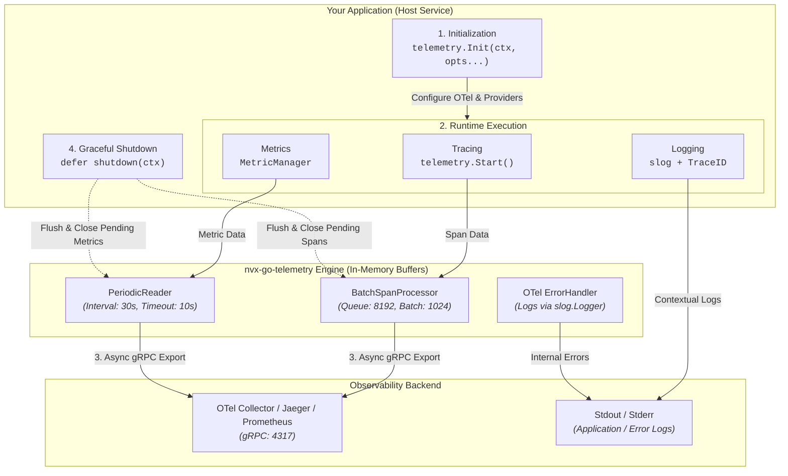
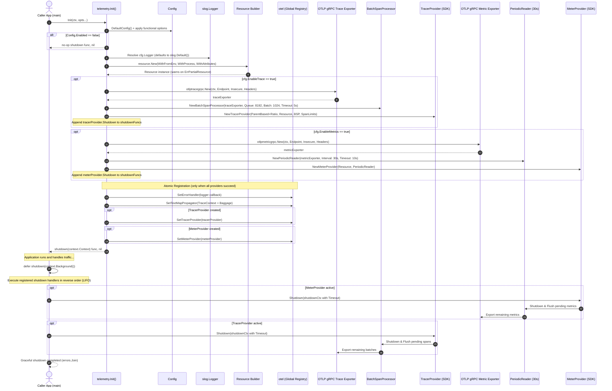
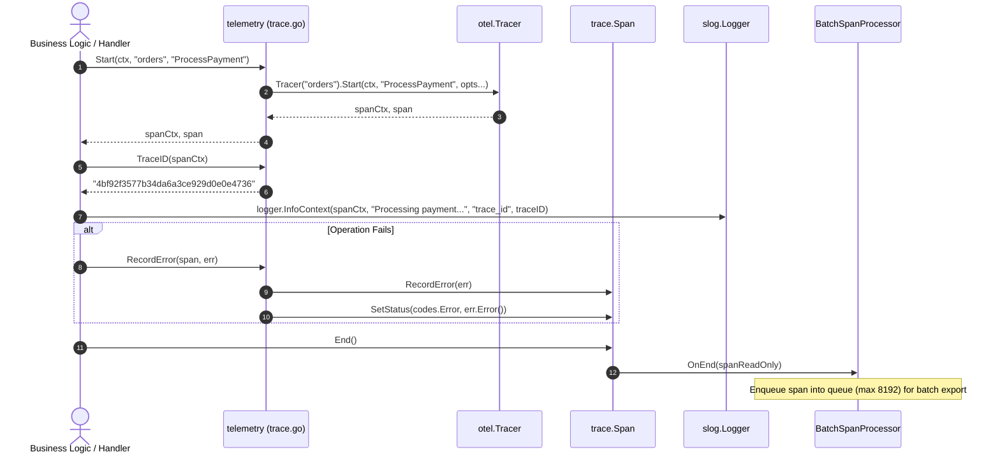
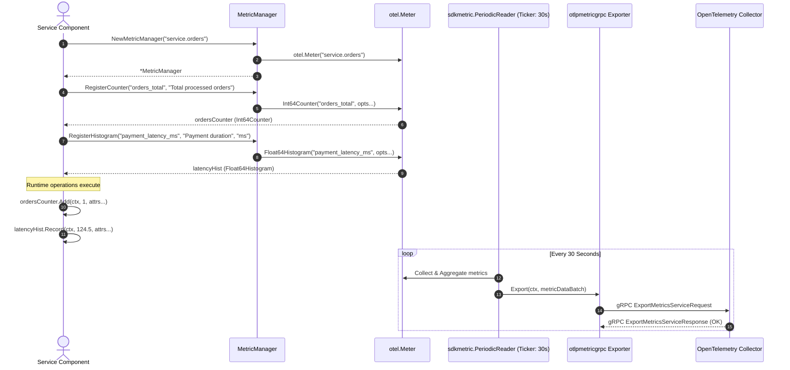
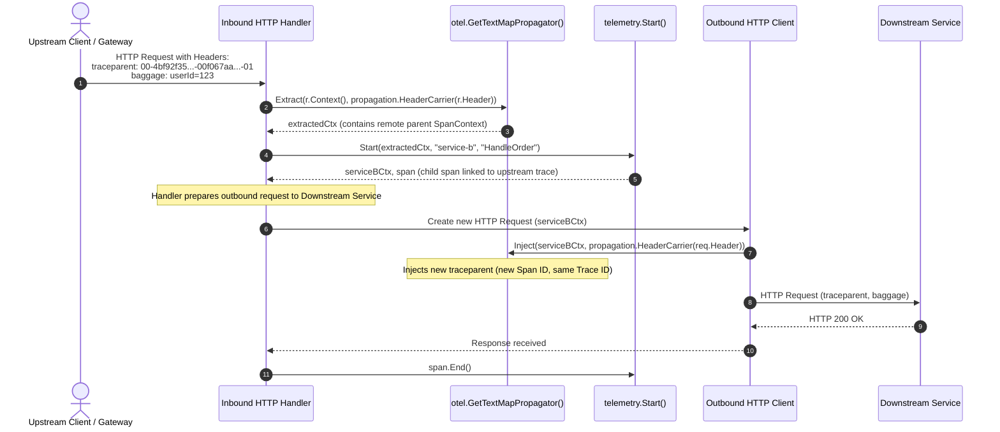

# Architecture & Telemetry Flow Diagrams

This document outlines the end-to-end architecture and detailed sequence diagrams for the lifecycle, tracing, metrics, and context propagation in [`nvx-go-telemetry`](../../telemetry).

---

## High-Level Architecture & Data Flow

Visual overview of how your application interacts with `nvx-go-telemetry`, internal in-memory buffers, and observability backends:

---

## 1. Telemetry Initialization & Graceful Shutdown

This diagram illustrates how [`telemetry.Init`](../../telemetry/otel.go) configures options, sets up the OpenTelemetry error handler using `slog`, instantiates OTel gRPC exporters & providers (traces & metrics), registers global propagators, and executes LIFO graceful shutdown with timeout contexts.

---

## 2. Tracing Flow & Error Capture

This diagram details the lifecycle of creating a span via [`telemetry.Start`](../../telemetry/trace.go), extracting Trace IDs for structured logging correlation, recording errors using [`telemetry.RecordError`](../../telemetry/trace.go), and dispatching data to `BatchSpanProcessor`.

---

## 3. Metrics Lifecycle & Periodic Harvesting

This diagram demonstrates metric instruments registration using [`MetricManager`](../../telemetry/metrics.go) and the periodic harvesting mechanism powered by OpenTelemetry SDK `PeriodicReader`.

---

## 4. Distributed Context Propagation (W3C TraceContext)

This diagram shows how TraceContext and Baggage headers are extracted from an incoming HTTP request and injected into downstream network calls to preserve distributed end-to-end trace correlation.

