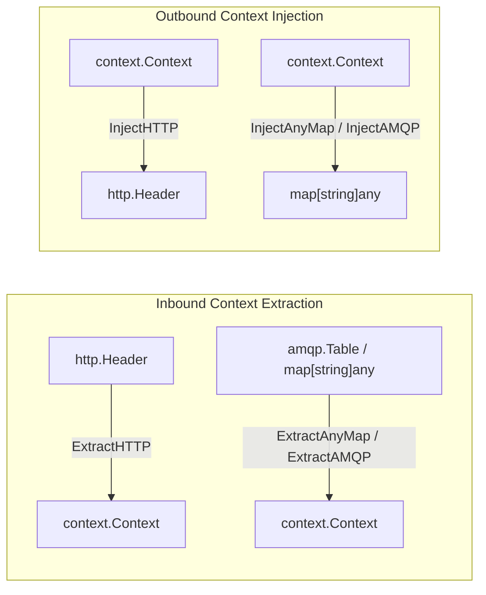
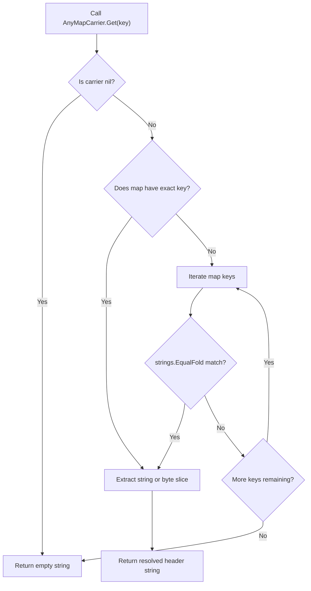

# Context Propagation Module

The [`carrier.go`](../../telemetry/carrier.go) file implements context propagation adapters for HTTP requests and message broker headers.

---

## 1. Overview

The module adapts Go data structures to the OpenTelemetry `TextMapCarrier` interface. It injects and extracts W3C `traceparent` and `baggage` values across service boundaries.



---

## 2. AnyMapCarrier Adapter

The `AnyMapCarrier` type adapts a raw `map[string]any` into a `propagation.TextMapCarrier`. Message brokers like RabbitMQ use table headers with heterogeneous value types.

### Key Resolution Logic
The `Get` method performs a two-tier key lookup:
1. It executes an exact match lookup on the provided key.
2. It falls back to a case-insensitive search with `strings.EqualFold` if the exact match fails.
3. It converts string values and byte slice (`[]byte`) values into Go strings.



---

## 3. Function Reference

| Function Interface | Parameter Types | Return Types | Operational Role (ASD-STE100) |
| :--- | :--- | :--- | :--- |
| `InjectHTTP(ctx, header)` | `context.Context`, `http.Header` | `void` | Writes trace context to HTTP headers. |
| `ExtractHTTP(ctx, header)` | `context.Context`, `http.Header` | `context.Context` | Reads trace context from HTTP headers. |
| `InjectHTTPHeader(ctx, header)` | `context.Context`, `http.Header` | `void` | Acts as an alias for `InjectHTTP`. |
| `ExtractHTTPHeader(ctx, header)` | `context.Context`, `http.Header` | `context.Context` | Acts as an alias for `ExtractHTTP`. |
| `InjectAnyMap(ctx, carrier)` | `context.Context`, `map[string]any` | `map[string]any` | Writes trace context to a map carrier. |
| `ExtractAnyMap(ctx, carrier)` | `context.Context`, `map[string]any` | `context.Context` | Reads trace context from a map carrier. |
| `InjectAMQP(ctx, carrier)` | `context.Context`, `map[string]any` | `map[string]any` | Acts as an alias for `InjectAnyMap`. |
| `ExtractAMQP(ctx, carrier)` | `context.Context`, `map[string]any` | `context.Context` | Acts as an alias for `ExtractAnyMap`. |

---

## 4. Usage Examples

### HTTP Context Propagation

```go
// Inbound HTTP handler
func Handler(w http.ResponseWriter, r *http.Request) {
    ctx := telemetry.ExtractHTTP(r.Context(), r.Header)
    ctx, span := telemetry.Start(ctx, "api", "ProcessRequest")
    defer span.End()

    // Outbound HTTP call
    req, _ := http.NewRequestWithContext(ctx, "POST", "http://downstream/api", nil)
    telemetry.InjectHTTP(ctx, req.Header)
}
```

### Messaging Context Propagation (RabbitMQ)

```go
// Outbound publisher
headers := make(map[string]any)
headers = telemetry.InjectAMQP(ctx, headers)

// Inbound consumer
consumerCtx := telemetry.ExtractAMQP(context.Background(), msg.Headers)
consumerCtx, span := telemetry.Start(consumerCtx, "worker", "ProcessJob")
defer span.End()
```
