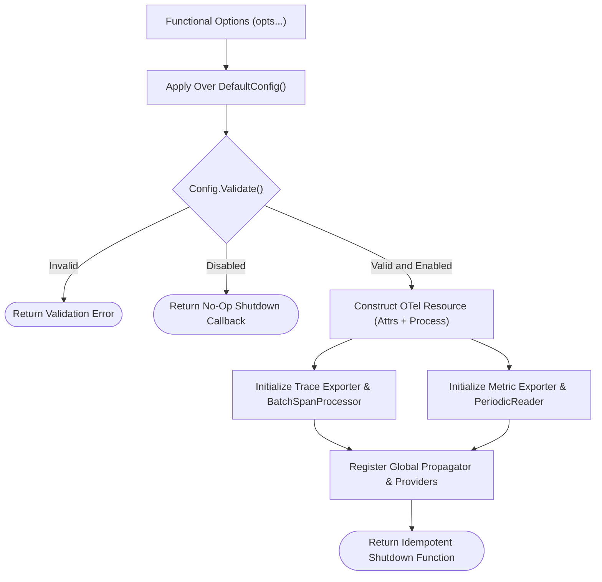
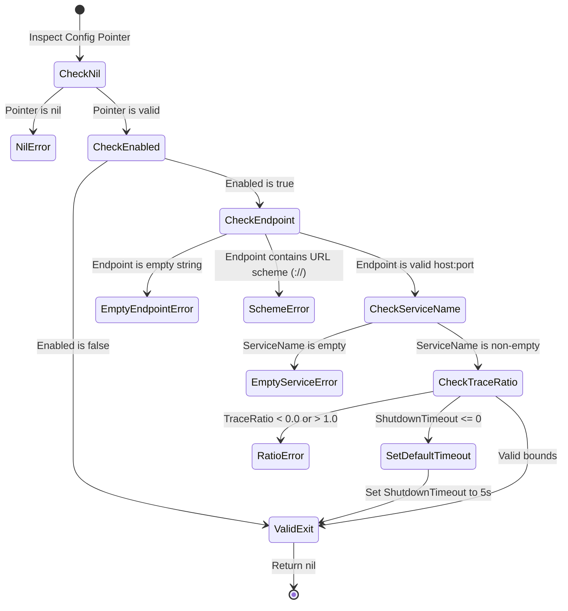

# Configuration and Lifecycle Module

The [`config.go`](../../telemetry/config.go) and [`otel.go`](../../telemetry/otel.go) files define OpenTelemetry initialization, configuration validation, and graceful shutdown handling.

---

## 1. Overview

The configuration module manages provider settings for tracing and metrics.
It validates endpoint formatting, enforces sampling bounds, and masks sensitive authentication headers.
The initialization function constructs batch processors and returns an idempotent shutdown callback.



---

## 2. Configuration Validation Rules

The diagram below shows the validation constraints evaluated in `Config.Validate()`.



### Procedural Steps (ASD-STE100)
1. Call `telemetry.Init` with desired functional options during application startup.
2. The function applies your settings over standard default configuration values.
3. The function validates endpoint formatting and rejects URL scheme prefixes (`http://`).
4. The function validates service names and sampling ratio limits.
5. Defer the returned shutdown function in the `main` entry point.
6. The shutdown function flushes queued spans and metrics within the configured timeout limit.

---

## 3. Configuration Parameters Reference

| Field Name | Type | Default Value | Description (ASD-STE100) |
| :--- | :--- | :--- | :--- |
| `Enabled` | `bool` | `true` | Enables or disables OpenTelemetry operations. |
| `Endpoint` | `string` | `"localhost:4317"` | Sets the OTLP gRPC collector target host and port. |
| `Insecure` | `bool` | `true` | Connects to the OTLP endpoint without transport encryption. |
| `Headers` | `map[string]string` | `nil` | Sets custom headers for authentication with OTLP collectors. |
| `ServiceName` | `string` | `"nvx-go-telemetry"` | Sets the logical service name attribute. |
| `Environment` | `string` | `""` | Sets the deployment environment attribute. |
| `ServiceVersion` | `string` | `""` | Sets the application version attribute. |
| `EnableTrace` | `bool` | `true` | Enables distributed trace recording and export. |
| `EnableMetrics` | `bool` | `true` | Enables runtime metric recording and export. |
| `TraceRatio` | `float64` | `1.0` | Sets head-based probabilistic sampling ratio from 0.0 to 1.0. |
| `ShutdownTimeout` | `time.Duration` | `5s` | Sets the maximum timeout limit for flushing buffers on exit. |
| `Logger` | `*slog.Logger` | `slog.Default()` | Sets a custom structured logger for internal telemetry errors. |

---

## 4. Functional Options Reference

| Functional Option | Parameter Type | Operational Role (ASD-STE100) |
| :--- | :--- | :--- |
| `WithEnabled(enabled)` | `bool` | Enables or disables telemetry operations. |
| `WithEndpoint(endpoint)` | `string` | Sets the OTLP gRPC endpoint address. |
| `WithInsecure(insecure)` | `bool` | Disables TLS transport encryption when connecting to collectors. |
| `WithHeaders(headers)` | `map[string]string` | Sets OTLP request headers with defensive map copying. |
| `WithServiceName(name)` | `string` | Sets the service name attribute. |
| `WithEnvironment(env)` | `string` | Sets the deployment environment attribute. |
| `WithServiceVersion(version)` | `string` | Sets the service version attribute. |
| `WithTraceEnabled(enabled)` | `bool` | Enables or disables distributed tracing. |
| `WithMetricsEnabled(enabled)` | `bool` | Enables or disables metric recording. |
| `WithTraceRatio(ratio)` | `float64` | Sets the sampling ratio from 0.0 to 1.0. |
| `WithShutdownTimeout(timeout)` | `time.Duration` | Sets the timeout limit for graceful shutdown flushes. |
| `WithLogger(logger)` | `*slog.Logger` | Sets a custom logger for internal OpenTelemetry errors. |
| `WithConfig(cfg)` | `*Config` | Applies settings from an existing configuration struct. |

---

## 5. Usage Examples

### 5.1 Basic Initialization

```go
package main

import (
	"context"
	"log"
	"time"

	"github.com/Jkenyut/nvx-go-telemetry/telemetry"
)

func main() {
	ctx := context.Background()

	// Initialize OpenTelemetry with options
	shutdown, err := telemetry.Init(
		ctx,
		telemetry.WithServiceName("payment-service"),
		telemetry.WithEnvironment("production"),
		telemetry.WithEndpoint("otel-collector:4317"),
		telemetry.WithInsecure(false),
		telemetry.WithShutdownTimeout(10*time.Second),
	)
	if err != nil {
		log.Fatalf("failed to initialize telemetry: %v", err)
	}
	defer func() {
		if err := shutdown(context.Background()); err != nil {
			log.Printf("error during telemetry shutdown: %v", err)
		}
	}()

	// Execute application workload
}
```

### 5.2 Header Masking and Stringer Support

```go
cfg := telemetry.DefaultConfig()
cfg.Headers = map[string]string{"Authorization": "Bearer sensitive-token-123"}

// The Stringer implementation automatically redacts sensitive header values
log.Println(cfg.String())
// Output includes: Headers:map[Authorization:[REDACTED]]
```
