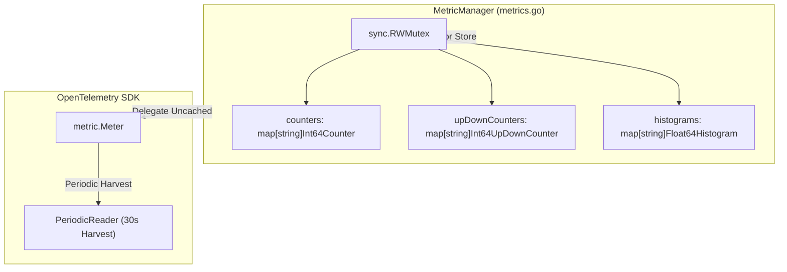
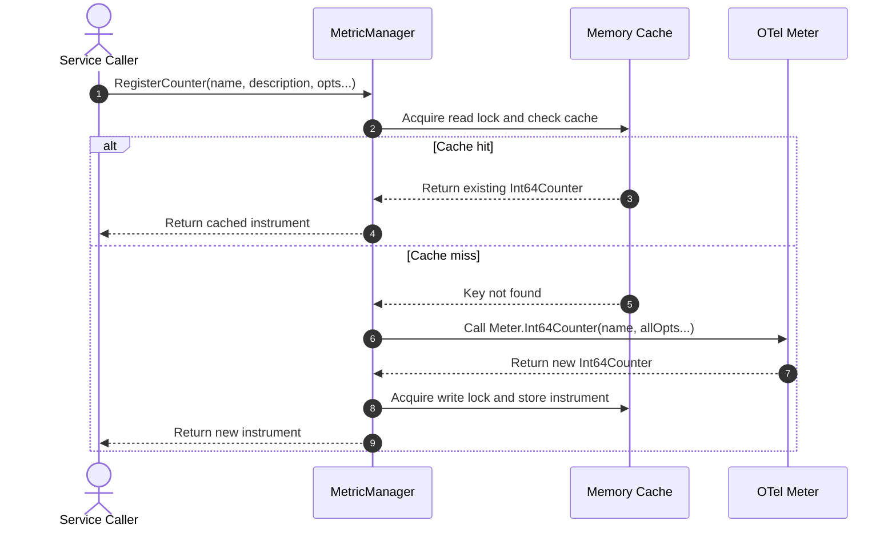

# Metrics Module

The [`metrics.go`](../../telemetry/metrics.go) file provides metric management wrappers with thread-safe instrument caching.

---

## 1. Overview

The `MetricManager` struct wraps the OpenTelemetry `metric.Meter` interface. It stores registered instruments inside internal maps protected by a `sync.RWMutex`. This design guarantees idempotent instrument instantiation across application components.



---

## 2. Instrument Caching Workflow

The sequence diagram below shows the read-lock check, meter delegation, and write-lock caching sequence.



---

## 3. Function Reference

| Function / Method | Parameter Types | Return Types | Operational Role (ASD-STE100) |
| :--- | :--- | :--- | :--- |
| `NewMetricManager(name)` | `string` | `*MetricManager` | Creates a new metric manager instance. |
| `RegisterCounter(name, desc, opts...)` | `string`, `string`, `...Option` | `Int64Counter`, `error` | Registers or returns a cached integer counter. |
| `RegisterUpDownCounter(name, desc, opts...)` | `string`, `string`, `...Option` | `Int64UpDownCounter`, `error` | Registers or returns a cached up-down counter. |
| `RegisterHistogram(name, desc, unit, opts...)` | `string`, `string`, `string`, `...Option` | `Float64Histogram`, `error` | Registers or returns a cached float64 histogram. |
| `MeasureFunc(name, desc, callback, opts...)` | `string`, `string`, `Int64Callback`, `...Option` | `Int64ObservableGauge`, `error` | Registers a callback to record an observable gauge. |
| `GetMeter()` | `none` | `metric.Meter` | Returns the underlying OpenTelemetry Meter. |

---

## 4. Usage Examples

### Counter and Histogram Tracking

```go
mm := telemetry.NewMetricManager("order-service")

// Register a monotonic counter
orderCounter, err := mm.RegisterCounter("orders_total", "Total created orders")
if err != nil {
    log.Fatal(err)
}
orderCounter.Add(ctx, 1)

// Register a duration histogram
latencyHist, err := mm.RegisterHistogram("payment_duration_seconds", "Payment duration", "s")
if err != nil {
    log.Fatal(err)
}
latencyHist.Record(ctx, 0.42)
```

### Observable Gauge Callback

```go
mm := telemetry.NewMetricManager("system-monitor")

// Register a gauge with runtime callback
gauge, err := mm.MeasureFunc("system_memory_usage_bytes", "Heap memory", func(ctx context.Context, obs metric.Int64Observer) error {
    var m runtime.MemStats
    runtime.ReadMemStats(&m)
    obs.Observe(int64(m.Alloc))
    return nil
})
```
