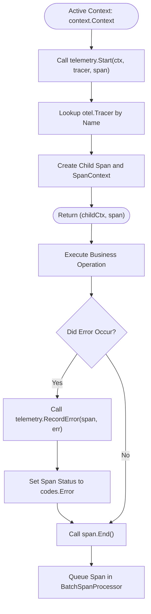
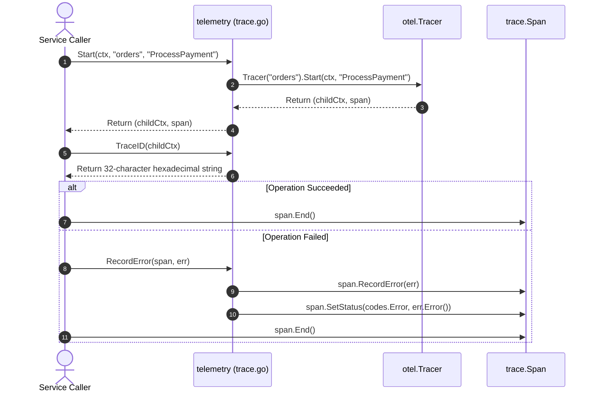

# Tracing Module

The [`trace.go`](../../telemetry/trace.go) file provides helper functions for OpenTelemetry span creation, trace correlation, and error logging.

---

## 1. Overview

The tracing module manages distributed trace lifecycles across Go applications.
It creates child spans, extracts hex-encoded trace identifiers, and records execution errors.
The package uses standard library `context.Context` to propagate spans across functions.



---

## 2. Span Lifecycle and Context Flow

The sequence diagram below shows span creation, trace ID extraction, and error handling.



### Procedural Steps (ASD-STE100)
1. Pass the active context, tracer name, and span name to `telemetry.Start`.
2. The function creates a child span and returns an updated context.
3. Always defer the `span.End()` method immediately after span creation.
4. Extract the active trace identifier with `telemetry.TraceID(ctx)`.
5. Attach the trace identifier to structured log entries.
6. Record execution errors with `telemetry.RecordError(span, err)`.
7. The error helper records the error and sets the span status to error.

---

## 3. Function Reference

| Function Interface | Parameter Types | Return Types | Operational Role (ASD-STE100) |
| :--- | :--- | :--- | :--- |
| `Tracer(name)` | `string` | `trace.Tracer` | Returns an OpenTelemetry tracer for the specified module. |
| `Start(ctx, tracer, span, opts...)` | `context.Context`, `string`, `string`, `...SpanStartOption` | `(context.Context, trace.Span)` | Starts a new child span from the active context. |
| `RecordError(span, err)` | `trace.Span`, `error` | `void` | Records an error event and sets error status on the span. |
| `TraceID(ctx)` | `context.Context` | `string` | Returns the active 32-character trace ID string from the context. |
| `SpanID(ctx)` | `context.Context` | `string` | Returns the active 16-character span ID string from the context. |

---

## 4. Usage Examples

### 4.1 Starting Spans and Recording Errors

```go
package main

import (
	"context"
	"errors"
	"log/slog"

	"github.com/Jkenyut/nvx-go-telemetry/telemetry"
)

func ProcessOrder(ctx context.Context, orderID string) error {
	// Start a child span
	ctx, span := telemetry.Start(ctx, "order-service", "ProcessOrder")
	defer span.End()

	// Extract trace ID for structured logging
	traceID := telemetry.TraceID(ctx)
	slog.InfoContext(ctx, "processing order", "order_id", orderID, "trace_id", traceID)

	if orderID == "" {
		err := errors.New("order_id cannot be empty")
		telemetry.RecordError(span, err)
		return err
	}

	return nil
}
```

### 4.2 Handling Nil Contexts Safely

```go
// Functions handle nil contexts safely by defaulting to context.Background
ctx, span := telemetry.Start(nil, "worker", "ExecuteJob")
defer span.End()

traceID := telemetry.TraceID(nil) // Returns empty string ""
spanID := telemetry.SpanID(nil)   // Returns empty string ""
```
